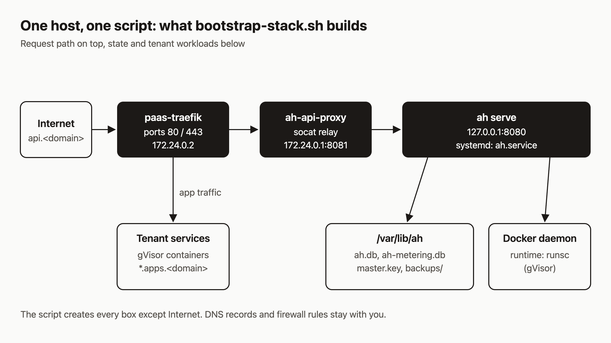

# Install agentic-hosting on a fresh Ubuntu 24.04 server

You have a cheap VPS and you want your own PaaS on it, one an AI agent can deploy to. The hard part is the wiring: Docker, the gVisor runtime, Nixpacks, a reverse proxy, a registry, systemd units, and a few secrets that all have to agree with each other. You can do that by hand. It takes an afternoon, and I would bet on one thing being subtly wrong at the end.

agentic-hosting ships a script that does the wiring. I think that is the right design: if an agent will operate this box, the setup should be the same every time. By the end of this post you will have the `ah` control plane running behind Traefik, a master key, a bootstrap token and an admin token on disk, and an HTTPS health check that passes from outside the box. You will be one `curl` away from registering your first tenant.

A note on what I checked: I checked every command below against the repo's code and docs. I did not run them for this post, so the output shapes are what the code produces, not a pasted terminal session.

## Prerequisites

- A clean Ubuntu 24.04 server. The script accepts amd64 or arm64 and refuses anything else.
- Root access, and `git` installed (`apt-get install -y git` if it is missing).
- A domain you control. This post uses `example.com`.
- An email address for Let's Encrypt notices.
- TCP 80 and 443 open to the internet. Restrict SSH to your own addresses.

Do not open TCP 8081. That port is an internal relay and the install notes say it must stay closed.

## 1. Look before you install

Clone the repo and run the script in dry-run mode first:

```sh
git clone https://github.com/dennisonbertram/agentic-hosting
cd agentic-hosting
sudo scripts/bootstrap-stack.sh --dry-run --domain example.com --acme-email you@example.com
```

A dry run changes nothing. It checks that this really is Ubuntu 24.04, that ports 80, 443, 5000, 8080 and 8081 are free, that `/var/lib/ah` and an existing Docker daemon config are absent, that no containers are running, and that the Docker subnet `172.24.0.0/24` does not overlap any Docker network or host route.

On success it prints one line:

```text
bootstrap: preflight passed for example.com; ingress 172.24.0.0/24, Traefik 172.24.0.2
```

If it fails, it tells you which check tripped. The script is deliberately strict. It will not merge into a host that already has state.

## 2. Run it for real

```sh
sudo scripts/bootstrap-stack.sh --domain example.com --acme-email you@example.com
```

It downloads and builds several things, so give it time. Here is what it installs:

- Docker from Docker's signed apt repository, with pinned package versions.
- gVisor (`runsc`) from its signed apt repository, registered as a Docker runtime in `/etc/docker/daemon.json`.
- Go and Nixpacks, with SHA-256 checks on both downloads. Go is used to build `ah` on the box. Nixpacks is what `ah` uses for git builds.
- Three system users for the API, the build worker and the relay.
- The `ah` binary at `/usr/local/bin/ah`, run by `ah.service`.
- A Docker bridge named `traefik-public` (`172.24.0.0/24`) and a registry container bound to `127.0.0.1:5000`.
- Traefik, configured with the file provider only. No Docker provider, no dashboard.
- `ah-api-proxy`, a small relay that carries traffic from Traefik to the API.
- A website container for `example.com` and `www.example.com`. Pass `--skip-website` if you only want the API and service ingress.

At the end the script polls `http://127.0.0.1:8080/v1/system/health` for up to 40 seconds. If that never succeeds, it prints the last 80 lines of the `ah` journal and exits with `API health check failed`.

## 3. Find your secrets

The script generates three secrets and does not print them.

| Secret | Where | What it is for |
|---|---|---|
| Master key | `/var/lib/ah/master.key` (mode 0600, owner `ah`) | 64 hex characters. `ah` requires exactly this format at startup. |
| Bootstrap token | `AH_BOOTSTRAP_TOKEN` in `/etc/default/ah` (root only) | Registering tenants. |
| Admin token | `AH_ADMIN_TOKEN` in `/etc/default/ah` (root only) | Recover, reactivate and quota endpoints. |

The code says what happens if the admin token is unset: `ah` logs a warning and also accepts bootstrap tokens on those endpoints, and that fallback is marked deprecated. The script sets both, so you are fine.

Back up `master.key` somewhere off the server. Treat it like a database password you cannot reset. Store the two tokens in a password manager too, and avoid pasting them into chat logs or tickets.

The script will refuse to run a second time. It sees `/var/lib/ah` and stops, on purpose. If a run dies halfway, do not delete state to force a rerun. Read the journal and follow the partial-failure notes in `docs/ops/fresh-install.md`.

## 4. Point DNS at the box

The script does not touch DNS. Add these records at your DNS provider, all pointing at the server's IPv4 address:

| Name | Type | Used for |
|---|---|---|
| `api` | A | The `ah` API at `https://api.example.com/v1/` |
| `*.apps` | A | Tenant services, each on its own `<name>.apps.example.com` host |
| `www` (optional) | A | The website container |

The wildcard matters. The script sets `AH_BASE_DOMAIN=apps.example.com`, so every tenant service gets a hostname under `apps.example.com`. One wildcard record covers all of them, and you never edit DNS again when you deploy something.

If you keep the website container, the apex `example.com` also needs an A record. Skip it if you used `--skip-website`.

Certificates come from Let's Encrypt over the HTTP challenge on port 80. They only issue once DNS resolves to your server, so expect a delay between adding records and a clean HTTPS response.

## 5. Check health, twice

First, on the server:

```sh
curl -H 'X-Forwarded-Proto: https' http://127.0.0.1:8080/v1/system/health
```

```json
{"status":"ok"}
```

The header is required. In production mode `ah` rejects requests from loopback that do not carry `X-Forwarded-Proto: https`. Traefik sets that header for real traffic.

Second, from your laptop, once DNS and the certificate are in place:

```sh
curl --fail --show-error https://api.example.com/v1/system/health
```

Same JSON. Do not use `curl -k` to make it pass. A certificate error means the certificate is not ready, and `-k` hides that.

## 6. Confirm Docker and gVisor

`GET /v1/system/health/detailed` needs a tenant API key, so this is the first reason to register a tenant. On the server, read the bootstrap token into a shell variable without printing it:

```sh
export AH_URL=https://api.example.com
export AH_BOOTSTRAP_TOKEN=$(sudo sed -n 's/^AH_BOOTSTRAP_TOKEN=//p' /etc/default/ah)

curl -s -X POST "$AH_URL/v1/tenants/register" \
  -H "X-Bootstrap-Token: $AH_BOOTSTRAP_TOKEN" \
  -H "Content-Type: application/json" \
  -d '{"name":"first-tenant","email":"you@example.com"}'
```

The response is `{"tenant_id":"...","api_key":"..."}`. The key is shown once, so save it as `$AH_API_KEY`. Then:

```sh
curl -s -H "Authorization: Bearer $AH_API_KEY" "$AH_URL/v1/system/health/detailed"
```

Look for `"docker":{"available":true,...}` and `"gvisor":{"available":true,...}`. The response also reports `disk`, `docker_disk` and some Docker storage figures. Results are cached for 30 seconds on the server.

## How it works

The diagram shows the request path.



Public traffic lands on the Traefik container `paas-traefik`, which owns ports 80 and 443 and has the fixed address `172.24.0.2` on the `traefik-public` bridge. Traefik cannot reach a service that listens on host loopback, so it sends API traffic to `ah-api-proxy`, a relay bound to the bridge gateway `172.24.0.1` on port 8081. The relay forwards to `ah` on `127.0.0.1:8080`. According to the install notes, it only accepts connections from Traefik's address.

Because the relay forwards from loopback, `ah` sees a loopback peer and trusts the `X-Forwarded-Proto` header Traefik adds. That is why your local check needs the header.

`ah` keeps its state in `/var/lib/ah`: `ah.db`, the metering database, and the master key. It also talks to the Docker daemon, which runs tenant containers under the `runsc` runtime. Tenant routes are written by `ah` as files that Traefik watches, so app traffic goes from Traefik straight to the tenant container without passing through `ah`.

## When it fails

Start with the log: `journalctl -u ah -f`.

- **`{"error":"HTTPS required"}`**: you called port 8080 directly without the header. Add `-H 'X-Forwarded-Proto: https'` or use the public HTTPS URL.
- **`gVisor is required`**: `ah` exits at startup in production if `runsc` is not among Docker's runtimes. Run `docker info | grep runsc` and check `/etc/docker/daemon.json`.
- **`master key must be 64 hex characters`**: the key file is malformed.
- **`AH_BOOTSTRAP_TOKEN must be set`**: `/etc/default/ah` is missing or empty.
- **Public HTTPS fails but local health works**: check DNS first, then `docker logs paas-traefik`. Certificates need DNS and port 80 to be reachable.

## What to try next

- Deploy a service: [Install and quickstart](https://agentic.hosting/docs/install/) and [Deploy from git](https://agentic.hosting/docs/deploy/)
- Understand the keys you just made: [Auth](https://agentic.hosting/docs/auth/)
- Read the rest of the failure catalog: [Troubleshooting](https://agentic.hosting/docs/troubleshooting/)
- See how the pieces fit: [Architecture](https://agentic.hosting/docs/architecture/)
- Star or read the source: [github.com/dennisonbertram/agentic-hosting](https://github.com/dennisonbertram/agentic-hosting)
