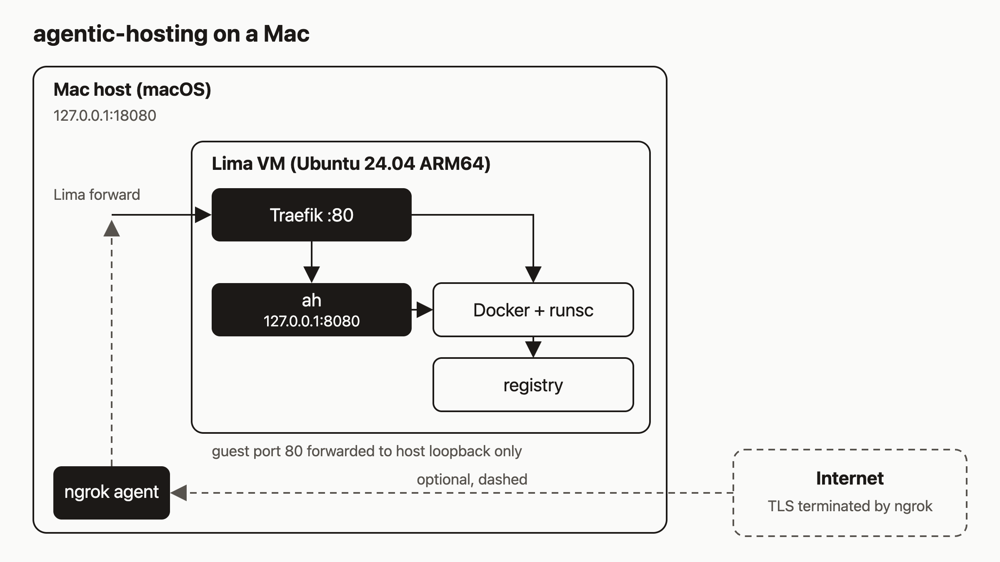

# Run agentic-hosting on a Mac with a Lima VM

You have an Apple Silicon Mac, and you want to see `ah` run before you rent a server or hand over a cloud account. I think that's the right order. If an agent is going to deploy things for you, you should watch it work on a machine you can throw away first. The catch is that `ah` uses Docker and gVisor (`runsc`) to isolate every service, and both need Linux. macOS can't run them directly.

So we use a small Linux VM. By the end of this post you'll have an Ubuntu 24.04 ARM64 VM managed by Lima, the whole `ah` stack running inside it, a health check passing on `127.0.0.1:18080`, and a first service deployed. If you want, you can also put it on the public internet with ngrok.



## What you need

- An Apple Silicon Mac. The wrapper script refuses to run on anything else.
- [Lima](https://lima-vm.io/docs/installation/). With Homebrew: `brew install lima`.
- Free disk space. The VM profile gives the guest 4 CPUs, 8 GiB of memory, and an 80 GiB virtual disk. Docker images and app data grow into your real disk.
- A checkout of the repo, with the commit you want to install checked out.
- A base domain you will use for URLs, such as `demo.example.com`. Pick it now. The installer uses it to generate service URLs. You don't need to own it or configure DNS for the local steps.
- Optional, later: the ngrok CLI, authenticated, with a reserved domain.

One thing will catch you out. The wrapper copies your code into the VM with `git archive HEAD`. Anything you haven't committed is not in the VM. Commit first.

## Step 1: Create the VM

From the repo root:

```sh
git clone https://github.com/dennisonbertram/agentic-hosting.git
cd agentic-hosting
scripts/bootstrap-macmini.sh create
```

This validates `deploy/lima-macmini.yaml`, then starts a Lima VM named `ah-macmini` with `--mount-none`. The profile pins an Ubuntu 24.04 ARM64 cloud image by SHA-256 and uses Apple's Virtualization.framework (`vmType: vz`). It sets `cpus: 4`, `memory: 8GiB`, `disk: 80GiB`, and `mounts: []`, so your Mac home directory is not visible inside the VM.

If the wrapper says the VM already exists, run `scripts/bootstrap-macmini.sh status`. Use `start` if it is stopped. `create` will not replace an existing VM.

## Step 2: Install the stack

Preview first. The dry run checks the domain and VM state and changes nothing:

```sh
scripts/bootstrap-macmini.sh bootstrap --domain demo.example.com --dry-run
scripts/bootstrap-macmini.sh bootstrap --domain demo.example.com
```

Use a lowercase parent domain with no `*.` prefix. The real run stages `git archive HEAD` into `/opt/agentic-hosting-<commit>` in the VM, then runs `scripts/bootstrap-stack.sh --domain ... --external-tls-terminated --skip-website`. That installs Docker with the `runsc` runtime, the `ah` API, and Traefik for HTTP ingress, and it skips the optional website container. It sets `AH_EXTERNAL_TLS_TERMINATED=true`, which I'll come back to.

Bootstrap is for a fresh VM only. If it fails partway, don't rerun it. Look at the services instead:

```sh
limactl shell ah-macmini sudo systemctl --no-pager --full status docker ah ah-api-proxy ah-build-broker
```

## Step 3: Check health through the forwarded port

The profile forwards guest port 80 to `127.0.0.1:18080` on your Mac. Traefik routes by hostname, so send the API hostname in a `Host` header:

```sh
DOMAIN=demo.example.com
curl --fail --show-error --write-out '\nHTTP %{http_code}\n' \
  -H "Host: api.$DOMAIN" http://127.0.0.1:18080/v1/system/health
```

Expected output:

```
{"status":"ok"}
HTTP 200
```

That is the route `GET /v1/system/health`, which is unauthenticated. It proves the request got from your Mac, through Lima, through Traefik, to `ah`. It says nothing about public DNS or TLS.

## Step 4: Register a tenant and deploy a service

Registering a tenant (`POST /v1/tenants/register`) needs the bootstrap token, which lives in `/etc/default/ah` inside the VM. The simplest path is to do the first calls from inside the guest, against `ah` on `127.0.0.1:8080`, so the token never leaves the VM:

```sh
limactl shell ah-macmini sudo bash -s <<'GUEST'
set -Eeuo pipefail
set -a; . /etc/default/ah; set +a
curl --fail --silent --show-error \
  -H 'X-Forwarded-Proto: https' \
  -H "X-Bootstrap-Token: $AH_BOOTSTRAP_TOKEN" \
  -H 'Content-Type: application/json' \
  -d '{"name":"mac-demo","email":"demo@example.com"}' \
  http://127.0.0.1:8080/v1/tenants/register
GUEST
```

The response has this shape:

```json
{"tenant_id": "...", "api_key": "..."}
```

Save the `api_key` somewhere safe. The `X-Forwarded-Proto: https` header is there because the API insists on HTTPS and only believes that header from a loopback caller. Registration is rate limited, so don't hammer it. The name must be 2 to 128 characters and the email must be valid.

Now create a service. This deploys the small `traefik/whoami` image, which listens on port 80:

```sh
export AH_API_KEY=...   # the api_key from the registration response
limactl shell ah-macmini sudo env AH_API_KEY="$AH_API_KEY" bash -s <<'GUEST'
curl --fail --silent --show-error \
  -H 'X-Forwarded-Proto: https' \
  -H "Authorization: Bearer $AH_API_KEY" \
  -H 'Content-Type: application/json' \
  -d '{"name":"demo-web","image":"traefik/whoami:v1.11.0","port":80}' \
  http://127.0.0.1:8080/v1/services
GUEST
```

The response is a service object with `id`, `name`, `status`, and `url`. Poll `GET /v1/services/{id}` until `status` is `running`. If it goes to `failed`, read `last_error` in the same object.

The service URL is `https://demo-web.apps.<your-domain>`. You can hit it locally without any DNS by using the Host header again:

```sh
curl -H "Host: demo-web.apps.$DOMAIN" http://127.0.0.1:18080/
```

You should get an HTTP 200 and whoami's plain-text description of the request.

## Optional: expose it with ngrok

If you want a public URL, copy the two endpoints from `deploy/ngrok-macmini.example.yaml` into your existing authenticated ngrok v3 agent config. Replace `example.com` with your domain:

```yaml
version: 3
endpoints:
  - name: ah-api
    url: https://api.example.com
    upstream:
      url: 127.0.0.1:18080
  - name: ah-services
    url: https://*.apps.example.com
    upstream:
      url: 127.0.0.1:18080
```

Both endpoints point at the same forwarded port. Don't replace your whole config with this file, because it holds no credentials. Then:

```sh
ngrok config check
ngrok start ah-api ah-services
```

The wildcard domain has to be reserved in your ngrok account first. Check your account for eligibility and any charges.

This setup has a tradeoff, and you should understand it before you use it. ngrok terminates TLS, so what arrives at Traefik is plain HTTP. With `--external-tls-terminated`, Traefik marks every plain-HTTP request as HTTPS so `ah` keeps generating HTTPS URLs. That is only safe here because the Lima profile forwards guest port 80 to host loopback and nowhere else. Don't use that flag on a machine whose port 80 is reachable from a network.

## How it works

Look at the diagram. Your Mac only exposes one thing: `127.0.0.1:18080`. Lima forwards it to port 80 in the guest, where Traefik sends API traffic to `ah` on `127.0.0.1:8080` and service traffic to containers. Docker runs those containers under `runsc`, and a registry in the guest holds images for git builds. The profile ignores every other guest port, so API and registry listeners stay private to the VM.

The dashed path is the optional one. The ngrok agent runs on the Mac and sends requests to the forwarded port. The internet reaches ngrok, and ngrok ends the TLS connection.

## Limits to know about

- The Mac has to stay awake, online, with the VM running and the ngrok agent running. If any stops, public requests fail. The setup doesn't change your power settings or start anything at boot.
- The repo's own notes say the local loopback requests were verified on an Apple Silicon Mac. The public ngrok DNS and TLS path is documented but has not been tested. The commands in this post were checked against the code and docs, and I did not run them for this post.
- Bootstrap is single-shot per VM. Plan to keep the VM, not rebuild it. I'd treat it as your local test server and keep anything important elsewhere.

## What to try next

- [Install & quickstart](https://agentic.hosting/docs/install/) for the standard Ubuntu server install
- [Deploy](https://agentic.hosting/docs/deploy/) for the full deploy flow, including git builds
- [Architecture](https://agentic.hosting/docs/architecture/) for how the pieces fit together
- [Troubleshooting](https://agentic.hosting/docs/troubleshooting/)
- The code: [github.com/dennisonbertram/agentic-hosting](https://github.com/dennisonbertram/agentic-hosting)
