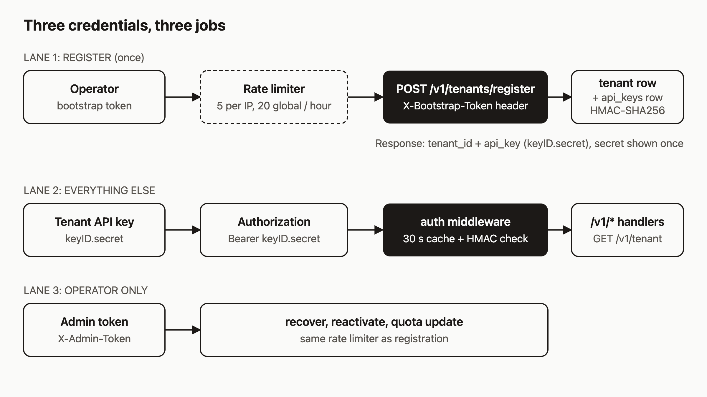

# Register a tenant and get your first API key

The first thing you hit with agentic-hosting is credentials. There are three, they sound alike, and only one is meant for daily work: the tenant API key. I think an agent should hold that one and nothing more, so the operator credentials stay out of its reach. By the end of this post you will have a registered tenant, an API key saved to disk, `ahc` configured to use it, and a clear idea of which credential to use when.

I checked the commands below against the source code but have not run them for this post. Treat the output shapes as what the code produces, not as a recorded session.



## The three credentials

- **Bootstrap token.** Held by the operator. It creates tenants: it goes in the `X-Bootstrap-Token` header on `POST /v1/tenants/register`. It is also what the validate endpoint in step 1 checks, and it is the fallback for the admin routes below when `AH_ADMIN_TOKEN` is not set.
- **Admin token.** Also held by the operator. It covers recover, reactivate, and quota updates, and goes in `X-Admin-Token`. If the server has `AH_ADMIN_TOKEN` set, a bootstrap token on those routes gets a 403. If it is not set, bootstrap tokens still work there, but the server warns at startup that this fallback is deprecated.
- **Tenant API key.** Held by you or your agent. It looks like `keyID.secret` and goes in `Authorization: Bearer ...`. Everything else uses it: deploys, databases, logs, and the rest.

You only need the bootstrap token today. Keep the admin token out of your agent's environment.

## Prerequisites

- A running `ah` server, and its URL. On the public service that is `https://api.agentic.hosting`. Self-hosted, use your own host. Examples below use `$AH_URL`.
- A bootstrap token from whoever runs the server. On a server you run yourself, this is the value of `AH_BOOTSTRAP_TOKEN`, and each token must be at least 32 characters.
- `curl`, and `ahc` if you want the CLI path.

```bash
export AH_URL="https://api.agentic.hosting"   # or your own host
export AH_BOOTSTRAP_TOKEN="<your bootstrap token>"
```

## Step 1: Check the bootstrap token

Before you register, you can ask the server whether it accepts the token. The token goes in a JSON body here, not in a header.

```bash
curl -s -X POST "$AH_URL/v1/system/bootstrap-token/validate" \
  -H "Content-Type: application/json" \
  -d "{\"token\":\"$AH_BOOTSTRAP_TOKEN\"}"
```

```json
{"valid":true}
```

A wrong token still returns HTTP 200, with `{"valid":false}`. The server also returns `false` when no tokens are configured, so the answer reveals nothing extra to someone guessing. Keep in mind that this call uses the same rate limiter as registration, so do not poll it.

## Step 2: Register with curl

```bash
curl -s -X POST "$AH_URL/v1/tenants/register" \
  -H "Content-Type: application/json" \
  -H "X-Bootstrap-Token: $AH_BOOTSTRAP_TOKEN" \
  -d '{"name":"my-agent","email":"agent@example.com"}'
```

A successful registration returns HTTP 201:

```json
{"tenant_id":"<hex id>","api_key":"<keyID>.<secret>"}
```

Copy `api_key` now. The server stores only an HMAC-SHA256 hash of the secret, computed with a key derived from its master key, so it cannot show the secret again. Save it somewhere your agent can read it:

```bash
export AH_API_KEY="<keyID>.<secret>"
```

Registration creates the tenant, a default quota row, and one API key named `default`, all in one database transaction. If any step fails, none of it is kept.

## Step 3: Register with ahc

The CLI does the same call. Name and email are positional arguments:

```bash
ahc --url "$AH_URL" register "my-agent" agent@example.com \
  --bootstrap-token "$AH_BOOTSTRAP_TOKEN" --save
```

You can leave out `--bootstrap-token` if `AH_BOOTSTRAP_TOKEN` is set in your environment. The flag wins if both are present. `ahc` needs a URL from somewhere: `--url`, `AH_URL`, or an existing config file.

The output prints the tenant ID, then a box telling you to save the key, then the key. Because you passed `--save`, it also prints `Saved to: ...` and writes the file:

```bash
cat ~/.ah/config.json
```

```json
{
  "url": "https://api.agentic.hosting",
  "key": "<keyID>.<secret>"
}
```

The URL saved is the one the client actually used for the call. The file is written with 0600 permissions, and its directory with 0700. If saving fails, `ahc` prints a warning but still shows the key, so you do not lose it.

If you registered with curl instead, you can write the same file yourself:

```bash
ahc configure --url "$AH_URL" --key "$AH_API_KEY"
```

Run `ahc configure` with no flags to see the current settings. It prints only the first 8 characters of the key.

`ahc` reads `AH_URL` and `AH_KEY` from the environment first, then the config file. Flags (`--url`, `--key`) override both.

## Step 4: Prove the key works

```bash
curl -s "$AH_URL/v1/tenant" -H "Authorization: Bearer $AH_API_KEY"
```

```json
{"id":"<hex id>","name":"my-agent","email":"agent@example.com","status":"active","created_at":1700000000,"updated_at":1700000000}
```

The timestamps are Unix seconds. The values above are placeholders. With `ahc` configured, `ahc tenant` makes the same call and also prints your usage and quotas.

If you get a 401, check that the header says `Bearer`, that the key has a dot between the two parts, and that you copied the whole thing.

## The rules registration enforces

- **Name:** 2 to 128 characters.
- **Email:** must look like an email address, up to 256 characters.
- **Duplicates:** a name or email that is already taken returns HTTP 422 with `registration failed, please check your details and try again`. The message is vague on purpose, so a stranger cannot learn which emails have accounts.
- **Rate limit:** 5 requests per IP per hour, and 20 per hour across the whole server. Over the limit, you get a 429 with a `Retry-After` header.
- **Tenant cap:** the server refuses to register more than 1000 active tenants.

On the rate limit, here is how the two counters differ. The per-IP counter goes up on every attempt, including ones with a wrong token, so guessing the bootstrap token burns through your five tries fast. The global counter goes up only after the token checks out, so a flood of bad guesses cannot use up everyone else's registrations. The validate endpoint from step 1 shares the same counters.

## How it works

Follow the diagram top to bottom.

In lane 1, the request passes the rate limiter first, then the bootstrap token check. The token is compared with HMAC rather than a plain string comparison, and the server can hold several comma-separated tokens at once, which is how you rotate one without downtime: configure `new,old`, move clients over, then drop `old`.

In lane 2, every authenticated request splits your key at the first dot into a key ID and a secret. The middleware looks up the key by ID, checks the HMAC of the secret, and checks the tenant is active. It caches a successful lookup for 30 seconds, so a revoked key can keep working for up to 30 seconds. Then the request reaches the `/v1/*` handler, which knows your tenant ID from the middleware and never from the request body.

Lane 3 is the operator side: the admin token for recover, reactivate, and quota changes. You will not need it unless you lose every key or an operator needs to change your limits.

## Local development: open registration

On your own machine you can skip the bootstrap token:

```bash
ah --dev --open-registration
```

With that, `POST /v1/tenants/register` works without the `X-Bootstrap-Token` header. The server refuses `--open-registration` without `--dev`, but nothing stops you from running `--dev` on a reachable port. Don't. Anyone who can reach the port can create tenants. The rate limiter still applies, but it does not control who gets in.

## What to try next

- Read the [registration and API keys reference](https://agentic.hosting/docs/auth/) for creating, listing, and revoking additional keys, so each agent gets its own.
- Follow the [install guide](https://agentic.hosting/docs/install/) if you have not set up a server yet.
- Deploy something with your new key: see the [deploy docs](https://agentic.hosting/docs/deploy/).
- Check the [rate limits page](https://agentic.hosting/docs/rate-limits/) to see how limits apply once you are authenticated.
- Browse the code and open issues at [github.com/dennisonbertram/agentic-hosting](https://github.com/dennisonbertram/agentic-hosting).
