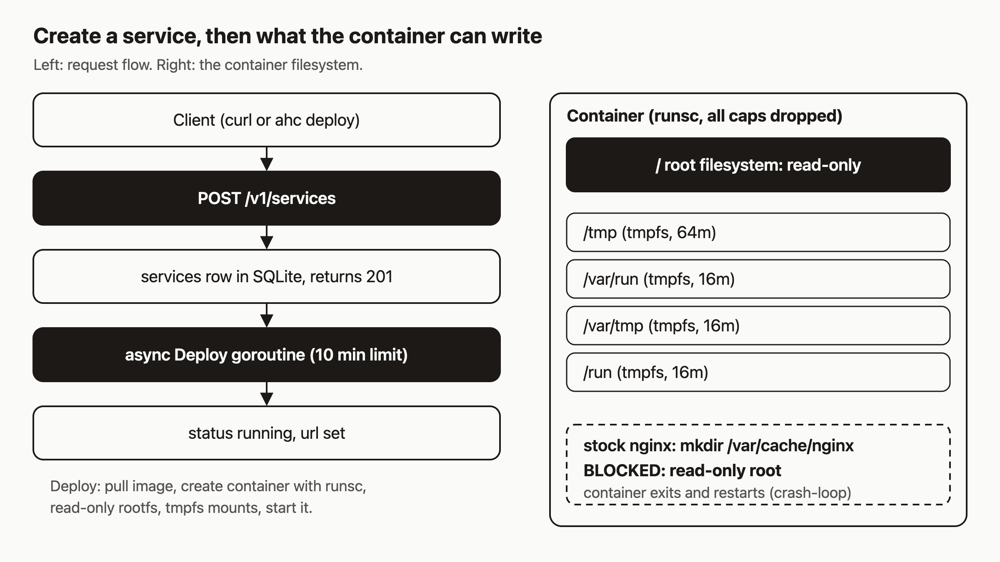

# Deploy a Docker image and open it in your browser

You have a Docker image and you want a URL. I think that should take one API call, because an AI agent can make an HTTP call but can't click through a dashboard.

By the end of this post you'll have an nginx service running on agentic-hosting with a URL you can open. You'll also know why the nginx image most of us reach for first (`nginx:alpine`) does not stay up here, and why `nginxinc/nginx-unprivileged` does. That detail trips up almost everyone's first deploy, so it's worth five minutes.



## Prerequisites

- A tenant and an API key. If you don't have one yet, the [install guide](https://agentic.hosting/docs/install/) and [auth guide](https://agentic.hosting/docs/auth/) cover registration.
- `curl` and `jq`.
- Optional: the `ahc` command line client.

The public API base is `https://api.agentic.hosting/v1/`. If you run your own host, swap in its address. Everything below uses two shell variables:

```bash
export AH_URL="https://api.agentic.hosting"
export AH_API_KEY="<keyID>.<secret>"   # your key, never commit it
```

Requests authenticate with `Authorization: Bearer <keyID>.<secret>`.

One note on how this post was made: I checked every command against the source code. I did not run them for this write-up, so the output blocks show the shape of the response, not captured output.

## Step 1: Create the service

Send one `POST /v1/services`. The body needs a `name` and an `image`. `port` is the port your app listens on. Add an `Idempotency-Key` header so a retry after a network hiccup doesn't create a second service.

```bash
curl -s -X POST "$AH_URL/v1/services" \
  -H "Authorization: Bearer $AH_API_KEY" \
  -H "Content-Type: application/json" \
  -H "Idempotency-Key: $(uuidgen)" \
  -d '{"name":"my-site","image":"nginxinc/nginx-unprivileged","port":8080}' \
  | tee service.json
```

You get back `201 Created` right away, with the row as it exists now:

```json
{
  "id": "<32-char hex id>",
  "name": "my-site",
  "status": "deploying",
  "image": "nginxinc/nginx-unprivileged",
  "port": 8080,
  "crash_count": 0,
  "circuit_open": false
}
```

The deploy has not finished. The handler writes the row, starts the deploy in a background goroutine with a 10 minute limit, and returns. That's why the response says `deploying`.

About the idempotency key: the server remembers the response for 10 minutes. Send the same key with the same body and you get the stored response back with an `Idempotency-Replayed: true` header. Send the same key with a different body and you get `409`. Keys can be up to 128 characters, and the check only applies to POST and PUT requests.

## Step 2: Wait for `running`, then read the URL

Poll `GET /v1/services/{id}` until `status` is `running`:

```bash
ID=$(jq -r .id service.json)
until [ "$(curl -s -H "Authorization: Bearer $AH_API_KEY" "$AH_URL/v1/services/$ID" | jq -r .status)" = "running" ]; do
  sleep 2
done
curl -s -H "Authorization: Bearer $AH_API_KEY" "$AH_URL/v1/services/$ID" | jq -r .url
```

(That loop never gives up. If you script this for real, also stop when `status` becomes `failed`, `crashed` or `error`, which is what the `ahc` client does.)

Once the service is running, the `url` field is filled in. Open it in a browser and you'll see the nginx welcome page.

## Step 3: The same thing with `ahc`

The CLI does steps 1 and 2 in one command. Point it at your host first:

```bash
ahc configure --url "$AH_URL" --key "$AH_API_KEY"
ahc deploy nginxinc/nginx-unprivileged my-site --port 8080
```

It prints something like this (the dots are one poll every 2 seconds):

```text
Deploying image nginxinc/nginx-unprivileged as "my-site"...
Service "my-site" created (id: 1a2b3c4d)
Waiting for service to start.....
  URL: <your service url>
```

`ahc` gives up after 150 polls, about five minutes. If the service lands in `failed`, `error` or `crashed`, it stops and prints the last error. An argument that starts with `http://` or `https://` is treated as a git repository to build instead of an image, which is a different tutorial.

## Step 4: Break it on purpose with stock nginx

Now deploy the image everyone tries first:

```bash
ahc deploy nginx:alpine my-site-stock --port 80
```

This service will not stay healthy, and the reason is the sandbox. Every container on agentic-hosting starts with these settings, set in `RunContainer` in `internal/docker/client.go`:

- The gVisor runtime (`runsc`)
- A read-only root filesystem
- All Linux capabilities dropped
- `no-new-privileges`
- A writable tmpfs (an in-memory filesystem) on only four paths: `/tmp`, `/var/run`, `/var/tmp` and `/run`

Stock nginx wants to create `/var/cache/nginx` when it starts. That path is on the root filesystem, the root filesystem is read-only, and `/var/cache` is not one of the four tmpfs mounts. The `mkdir` fails, nginx exits, and the container restart policy (`unless-stopped`) starts it again. That's the crash-loop the docs describe.

I did not capture the exact log line from a live run, so check it yourself:

```bash
ahc service get my-site-stock
ahc service logs my-site-stock --tail 50
```

The docs recommend `nginxinc/nginx-unprivileged` on port 8080 for this sandbox, and that's why the quickstart uses it.

If you leave the broken one alone, the reconciler counts crashes. Five crashes inside a 600 second window open the circuit breaker, which stops and removes the container. After that, `start` returns `409` because there's no container. Use `redeploy` instead. The [reconciliation page](https://agentic.hosting/docs/reconciliation/) has the details.

Clean up the experiment before moving on:

```bash
ahc service delete my-site-stock --confirm
```

## Step 5: Which images the validator accepts

Before anything is stored, `services.ValidateImage` checks the `image` field. In practice:

- **Docker Hub names work.** `name`, `name:tag` and `org/name:tag`, all lowercase.
- **The loopback registry works only for your own images.** `127.0.0.1:5000/...` is the platform's internal registry. It accepts the images your builds and snapshots produce, and nothing else. Another tenant's image is rejected.
- **Other registries are rejected.** If the first path segment contains a `.` or a `:` (like `ghcr.io/org/app`), you get `custom registries not allowed`. `localhost` is rejected too.
- **Bad shapes are rejected.** An empty image, one longer than 256 characters, or one that doesn't match the Docker Hub pattern (uppercase letters, a digest, more than `org/name`) returns `400`.

The same endpoint also rejects a `name` over 128 characters and an explicit `port` outside 1 to 65535. Leave `port` out (or send `0`) and it defaults to 8000.

## Step 6: Stop, start, restart, delete

```bash
ahc service stop my-site
ahc service start my-site
ahc service restart my-site
ahc service delete my-site --confirm
```

These map to `POST /v1/services/{id}/stop`, `/start`, `/restart` and `DELETE /v1/services/{id}`. Stop returns `{"status":"stopped"}`, start and restart return `{"status":"running"}`, and delete returns `204`. The CLI refuses to delete without `--confirm`, since delete removes the container, env vars and deployment history.

## About that URL

What `url` looks like depends on how the host was started:

| Host started | URL |
|---|---|
| without `--base-domain` | `http://{serviceID}.localhost` |
| with `--base-domain apps.example.com` | `https://{dns_label}.apps.example.com` |

The `dns_label` is picked when you create the service and does not change if the host later restarts with a different base domain. The `.localhost` form is for local runs.

## How it works

Look at the diagram again. The left side is the create path. Your request hits `POST /v1/services`, the handler validates it and writes a `services` row to SQLite, and it returns `201` before any image has been pulled. A goroutine then does the slow part. It makes sure your tenant's network exists, pulls the image, creates the container with `runsc`, and starts it. When that succeeds, the same goroutine sets `status` to `running` and writes the `url`. If something fails along the way, the row goes to `failed` and `last_error` tells you why.

The right side is what that container can touch. The root filesystem is read-only, and four small tmpfs mounts are the only places it can write. An image that needs to write anywhere else, like `/var/cache/nginx`, will fail at startup. I'd make that the first thing you check when a deploy of an image you didn't build misbehaves.

## What to try next

- Pass environment variables with `"env": {"KEY":"val"}` on create. See [environment variables](https://agentic.hosting/docs/env/).
- Deploy from a git repo instead of an image: [Deploy from git](https://agentic.hosting/docs/deploy/).
- Read what the sandbox protects you from: [Security](https://agentic.hosting/docs/security/).
- See why a service keeps restarting: [Troubleshooting](https://agentic.hosting/docs/troubleshooting/) and [Crash-loop and disk guards](https://agentic.hosting/docs/guards/).
- Browse the full [API reference](https://agentic.hosting/docs/api/).
- Star or fork the code: [github.com/dennisonbertram/agentic-hosting](https://github.com/dennisonbertram/agentic-hosting).
