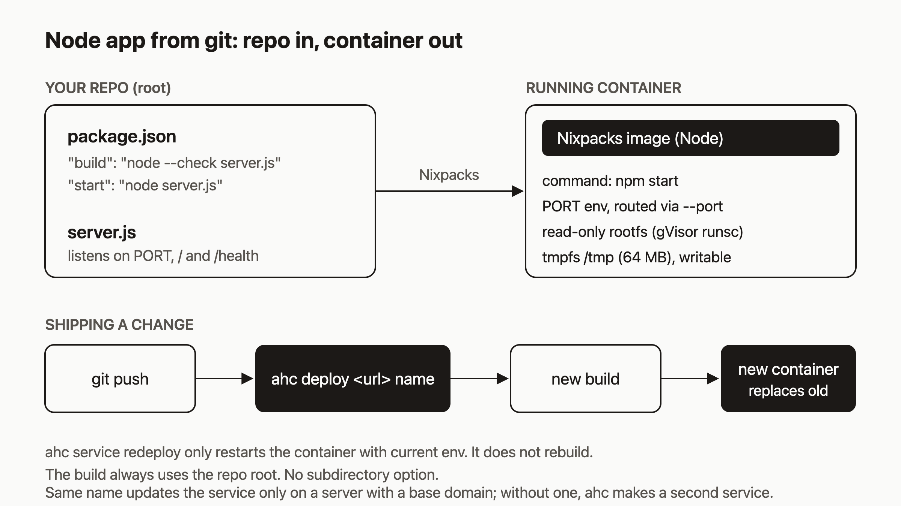

# Deploy a Node.js app from git and keep it running

Deploying a small Node API should take one command, and an agent should be able to run it as easily as you can. That is the bar I care about. Say you have a small Node API on a Heroku-style host today. By the end of this post you will have a Node HTTP service built by Nixpacks from a GitHub repo, listening on the port you chose, with `NODE_ENV` set, and a second version shipped over the first.



I checked every command below against the source code. I have not run this exact walkthrough end to end, so treat the sample output as the rough shape of what you will see, not a transcript.

## Prerequisites

- An agentic-hosting account and API key. The public API is at `https://api.agentic.hosting/v1/`. If you self-host, use your own host.
- The `ahc` CLI, configured once:

```bash
ahc configure --url https://api.agentic.hosting --key "$AH_API_KEY"
```

  `ahc` also reads `AH_URL` and `AH_KEY` from the environment.
- Node and git locally, and a GitHub account. Builds clone over HTTPS from `github.com`, `gitlab.com`, `bitbucket.org`, `sr.ht`, or `codeberg.org`.

## Step 1: Write the app

Make a new repo with two files. `server.js`:

```js
const http = require("node:http");

const port = Number(process.env.PORT) || 3000;

http
  .createServer((req, res) => {
    res.setHeader("Content-Type", "application/json");
    if (req.url === "/health") return res.end('{"ok":true}');
    res.end(JSON.stringify({ hello: "world", env: process.env.NODE_ENV || "unset" }));
  })
  .listen(port, "0.0.0.0", () => console.log(`listening on ${port}`));
```

And `package.json`:

```json
{
  "name": "node-demo",
  "private": true,
  "version": "1.0.0",
  "scripts": {
    "build": "node --check server.js",
    "start": "node server.js"
  }
}
```

The `build` and `start` scripts follow the same pattern as `examples/openrouter-agent/package.json` in the agentic-hosting repo, which uses a `node --check` build step and `node server.mjs` for start. The server binds to `0.0.0.0`, not `localhost`, so traffic from outside the container can reach it.

Run it once locally with `npm start` and `curl localhost:3000/health` to confirm it works.

## Step 2: Push to GitHub and deploy

```bash
git init && git add . && git commit -m "first version"
git branch -M main
git remote add origin https://github.com/YOU/node-demo.git
git push -u origin main

ahc deploy https://github.com/YOU/node-demo node-demo --port 3000
```

`ahc deploy` treats any `http://` or `https://` source as a git repo. It creates a service named `node-demo`, starts a build, streams the build log, waits for the service to reach `running`, and prints the URL. Expect output of roughly this shape:

```
Deploying https://github.com/YOU/node-demo as "node-demo"...
Service "node-demo" created (id: 1a2b3c4d)
Starting build...
Build started (id: ...)
[build] ...
Waiting for service to start....
  URL: http://<service-id>.localhost
```

Without a configured base domain the URL ends in `.localhost`. With one (`--base-domain apps.example.com` on the server) it is `https://<dns_label>.apps.example.com`.

The git ref defaults to `main`, so name your branch `main` or the clone will fail.

The `--port` value is the port the platform routes traffic to. If you leave it out, the service falls back to 8000. Match it to the port your server listens on.

## Step 3: Read the build log

The log streams during the deploy. To read it again later:

```bash
ahc build logs node-demo
```

With no build ID it shows the latest build. Lines from the builder start with `[ah]`, for example `[ah] Running nixpacks build...`. The rest is raw output from `git clone` and `nixpacks build`. The builder runs `nixpacks build` on the cloned repo root and streams its output. Nixpacks is designed to detect a Node project from `package.json`, but I have not captured its output here, so read your own log to confirm which install, build, and start commands it chose, and that it picked `npm start`.

## Step 4: Set an env var and apply it

```bash
ahc service env set node-demo NODE_ENV=production
# 1 variable updated. Run 'ahc service redeploy node-demo' to apply.

ahc service redeploy node-demo
# Service "node-demo" redeployed (status: running)
```

Env vars are stored encrypted and only reach the container when it is recreated. `ahc service redeploy` recreates the container from the image already built, with the current env. It does not rebuild your code. Check the value with `ahc service env get node-demo --reveal`; without `--reveal`, values show as `***`.

One port detail. The platform does not set `PORT` for you. Your server's `process.env.PORT || 3000` falls back to 3000, which matches `--port 3000`. If you set a `PORT` env var yourself, the platform routes to that port instead of the `--port` value, so keep the two in agreement.

Request the URL from step 2 and you should see `"env":"production"`.

## Step 5: Ship a change

Edit `server.js` (change `hello: "world"` to `hello: "again"`), then:

```bash
git commit -am "second version" && git push
ahc deploy https://github.com/YOU/node-demo node-demo --port 3000
```

The second `deploy` tries to create `node-demo`, which already exists. When the server has a base domain, the create fails because the name maps to a DNS label that is already taken, so the CLI looks the service up by name prints `Using existing service "node-demo"`, and starts a fresh build from the latest commit. When the build succeeds, the old container is stopped and removed and a new one starts from the new image.

This reuse depends on the create call failing. If the server has no base domain (the localhost setup), duplicate service names are allowed, the create succeeds, and `ahc deploy` makes a second service called `node-demo` instead of updating the first. In that case, delete the old service or rebuild it by id with the API.

Do not use `ahc deploy --redeploy node-demo` for this. It calls the same endpoint as `ahc service redeploy` and restarts the container without a new build, so your push would not appear. (The docs page on deploys describes `POST /v1/services/{id}/redeploy` as starting a new build. The handler in the code only restarts, and I went with the code.)

See the history:

```bash
ahc service deployments node-demo
```

The table has columns `ID`, `STATUS`, `TRIGGER`, `IMAGE`, and `STARTED`. Builds show up with trigger `build` and restarts with trigger `restart`, so you can tell which deploy changed code and which only changed config.

## How it works

The diagram shows the path: your repo on the left, the running container on the right. Here is what happens in between.

1. `ahc deploy` creates the service with a placeholder image (`"pending"`), then calls `POST /v1/services/{id}/builds` with `source_type: "git"` and your URL.
2. A build worker runs `git clone --depth=1 --branch main` and then `nixpacks build` on the clone, tagging the image in the local registry.
3. On success the platform stops and removes the old container, creates a new one from the new image, and updates the service to `running`.
4. The container runs under gVisor (`runsc`) with all Linux capabilities dropped, 512 MB of memory and one CPU by default, and a read-only root filesystem. Only `/tmp`, `/var/tmp`, `/var/run`, and `/run` are writable (tmpfs, `/tmp` is 64 MB and `noexec`).

Two limits matter here:

- **Write only to temp paths.** Anything outside those tmpfs mounts fails with a read-only error, and tmpfs contents disappear on restart. Put real data in a database, not on disk.
- **The build uses the repo root.** The build request has `source_type`, `source_url`, and `source_ref` and nothing else, so you cannot point it at a subdirectory of a monorepo. Put the service in its own repo, or in a repo whose root is the service.

## What to try next

- [Deploy from git](https://agentic.hosting/docs/deploy/): allowed hosts, refs, cancelling builds, and concurrency limits.
- [Env vars and secrets](https://agentic.hosting/docs/env/): how values are validated, encrypted, and revealed.
- [Troubleshooting](https://agentic.hosting/docs/troubleshooting/): what to check when a build or container fails.
- [Databases](https://agentic.hosting/docs/databases/): somewhere to keep data now that the filesystem is read-only.
- Source and issues: [github.com/dennisonbertram/agentic-hosting](https://github.com/dennisonbertram/agentic-hosting).
