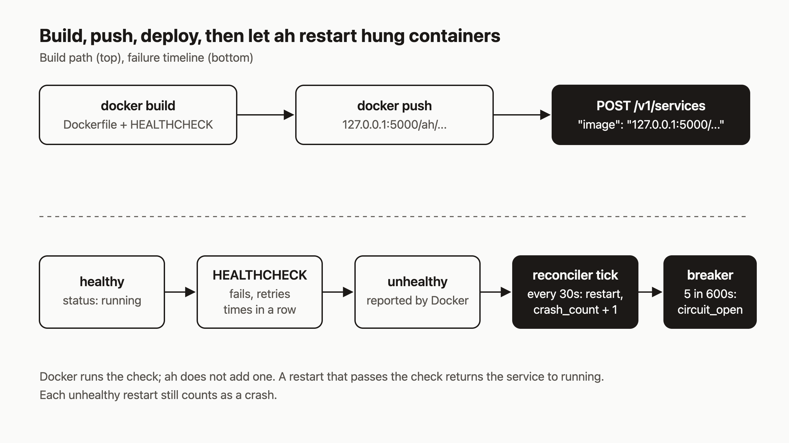

# Build your own image, push it to the local registry, and add a HEALTHCHECK

An app that crashes is easy to deal with, because the process exits and Docker restarts it. An app that hangs is harder: the process is alive, the port is open, and nothing answers. Docker will not fix that on its own, because the process never exits. If an AI agent is running your services, I think this is the failure you most want handled without a human. By the end of this post you will have a custom image running on agentic-hosting (`ah`) as a non-root user on a read-only root filesystem, with a HEALTHCHECK that makes `ah` restart the container when it stops answering. You will also watch the restart counter and the circuit breaker react.



The commands below were checked against the `ah` source. They were not executed for this post, so expect to adjust small details such as IDs and timing.

## Prerequisites

- A self-hosted `ah` server and shell access to it. The loopback registry listens on `127.0.0.1:5000` on that machine, so you push from the server (see the install guide).
- Docker on that server, and an API key. `$AH_URL` is your server, for example `http://localhost:8080` (use your own address). Requests send `Authorization: Bearer $AH_API_KEY`.
- Your tenant ID, which registration returns as `tenant_id`. Export it as `$TENANT_ID`.

## 1. Know which images ah accepts

`services.ValidateImage` allows two kinds of image reference and rejects the rest:

- Docker Hub names such as `name`, `name:tag`, or `org/name:tag`.
- The loopback registry, `127.0.0.1:5000/<ns>/<name>`, with at least two path segments after the host.

One more rule matters for custom images. A local-registry image must belong to your tenant, so the path must start with `ah/$TENANT_ID-` (snapshot images use `snapshots/$TENANT_ID:`). Anything else under `127.0.0.1:5000` returns `400` with `local registry image does not belong to this tenant`. Any host with a dot or colon in it, including `localhost:5000`, is rejected as a custom registry.

So we will tag the image `127.0.0.1:5000/ah/$TENANT_ID-hangs`.

## 2. Write a Dockerfile that fits the sandbox

Every service container runs under gVisor with all capabilities dropped, `no-new-privileges`, and a read-only root filesystem. The only writable paths are tmpfs mounts at `/tmp`, `/var/run`, `/var/tmp`, and `/run`. Your image has to run under those rules.

The repo's `examples/openrouter-agent/Dockerfile` shows the shape: a pinned base, files copied with the right owner, `USER node`, and no writes outside the app directory. Here is a small server in the same style. Save this as `server.mjs`:

```js
import http from "node:http";

http.createServer((req, res) => {
  if (req.url === "/hang") {
    // Block the event loop forever. The process stays alive but stops answering.
    for (;;) {}
  }
  res.end("ok\n");
}).listen(3000);
```

And the Dockerfile:

```dockerfile
FROM node:24.15.0-alpine3.22@sha256:b689d4005875ae167178471a7a622ec2909459a3bbb32277260be1971af7a99f

ENV NODE_ENV=production PORT=3000
WORKDIR /app
COPY --chown=node:node server.mjs ./

USER node
EXPOSE 3000

HEALTHCHECK --interval=10s --timeout=3s --start-period=5s --retries=3 \
  CMD wget -q -O /dev/null http://127.0.0.1:3000/ || exit 1

CMD ["node", "server.mjs"]
```

The base image digest is the one the example uses. Pin your own the same way.

## 3. Use a check tool the image really has

`ah` does not add a HEALTHCHECK for you. The `RunContainer` comments say health checks are left to the image author, because many images have no `curl` or `wget`. I think that is the right call, since `ah` cannot know what "healthy" means for your app. The catch is that if your image has no HEALTHCHECK, Docker reports no health status and the reconciler never sees `unhealthy`.

This image is Alpine, which ships BusyBox `wget`, so the check calls that. On a distroless or `scratch` image there is no shell and no `wget`, so build the check into your app binary instead (for example a `healthcheck` subcommand) and call it from `CMD`.

With `--interval=10s --retries=3`, a hung app is marked unhealthy after about three failed checks, roughly 30 seconds.

## 4. Build, push, and create the service

On the server:

```bash
docker build -t 127.0.0.1:5000/ah/$TENANT_ID-hangs:v1 .
docker push 127.0.0.1:5000/ah/$TENANT_ID-hangs:v1
```

Then create the service. `image` and `name` are required, and `port` must be between 1 and 65535 (the default is 8000 if you leave it out, so set it):

```bash
curl -s -X POST "$AH_URL/v1/services" \
  -H "Authorization: Bearer $AH_API_KEY" \
  -H "Content-Type: application/json" \
  -d "{\"name\":\"hangs\",\"image\":\"127.0.0.1:5000/ah/$TENANT_ID-hangs:v1\",\"port\":3000}"
```

The response is `201` with the service, and its `status` is `deploying`. The deploy runs in the background with a 10 minute limit. Poll until it says `running`:

```bash
curl -s "$AH_URL/v1/services/$SERVICE_ID" -H "Authorization: Bearer $AH_API_KEY"
# {"id":"...","status":"running","image":"127.0.0.1:5000/ah/...","port":3000,
#  "crash_count":0,"circuit_open":false, ...}
```

## 5. Make it hang

Send a request to `/hang`. Use your service's URL from the `url` field (the route may take a moment after deploy):

```bash
curl -m 5 "$SERVICE_URL/hang"   # times out: the event loop is blocked
```

On the server, watch Docker's view of the container:

```bash
docker ps --filter "label=ah.service" --format '{{.Names}}\t{{.Status}}'
# ah-<tenant>-<service>   Up 2 minutes (health: starting)  ->  (unhealthy)
```

After roughly three failed checks Docker reports `unhealthy`. Docker does nothing more. The restart policy is `unless-stopped`, which only reacts when the process exits.

## 6. Watch the reconciler restart it

The reconciler runs every 30 seconds (`cmd/ah/main.go` passes `30*time.Second`). On the first tick that sees a running container with health `unhealthy`, it does three things: it records one crash event, marks the service `crashed`, and restarts the container. If you run `ah` yourself, the log line is:

```
reconciler: service <id> container <short-id> is unhealthy — restarting
```

The worst-case wait is the health check delay plus one tick, so expect up to a minute or so. The restarted process serves requests again. On a later tick with no new crash events, once Docker reports the container running and its health is empty, `healthy`, or `none` (not `starting`), the stored status goes back to `running`.

## 7. Repeat until the breaker opens

Hit `/hang` again after each recovery and check the service:

```bash
curl -s "$AH_URL/v1/services/$SERVICE_ID" -H "Authorization: Bearer $AH_API_KEY"
# {"status":"running","crash_count":2,"circuit_open":false, ...}
```

`GET /v1/services/{id}` replaces the stored status with Docker's live container state whenever a container exists, so you will usually see `running` here even while the stored status is `crashed`. Watch `crash_count` instead. It rises by one per unhealthy restart within a 600 second window. A crash outside the window starts a fresh count at 1. When `crash_count` reaches 5 inside the window, the breaker opens: `circuit_open` becomes `true`, and the container is stopped and removed.

An open circuit resets itself after a wait (30 minutes the first time, per `guards.md`), but it does not restart the service. To recover sooner, fix the app, then:

```bash
curl -s -X POST "$AH_URL/v1/services/$SERVICE_ID/reset"    -H "Authorization: Bearer $AH_API_KEY"
curl -s -X POST "$AH_URL/v1/services/$SERVICE_ID/redeploy" -H "Authorization: Bearer $AH_API_KEY"
```

## How it works

Read the diagram top to bottom. The top row is the delivery path: build, push to the loopback registry, and `POST /v1/services` with an image name that passes `ValidateImage`. The bottom row is the failure path. Docker owns the health check and the `unhealthy` label. `ah` owns the response: the reconciler inspects each `running` or `crashed` service every 30 seconds, treats `unhealthy` as a crash, restarts the container, and updates `crash_count`. The restart is explicit because a container that someone stopped by hand would stay stopped under `unless-stopped`. The circuit breaker exists so a service that hangs on every start does not restart forever.

Two things to plan for. A slow health check that fails because of load can trigger restarts, so set `--timeout` and `--retries` with real traffic in mind. Also, each restart counts toward the 5-in-600-seconds limit, so a check that fails too easily will open the breaker.

## What to try next

- Read how the loop and the breaker work in [Reconciliation](https://agentic.hosting/docs/reconciliation/) and [Crash-loop and disk guards](https://agentic.hosting/docs/guards/).
- See every way to get code onto `ah` in [Deploy](https://agentic.hosting/docs/deploy/), including git builds that push to the same registry.
- Troubleshoot a deploy that fails to start in [Troubleshooting](https://agentic.hosting/docs/troubleshooting/).
- Read the source and the example Dockerfile at [github.com/dennisonbertram/agentic-hosting](https://github.com/dennisonbertram/agentic-hosting).
