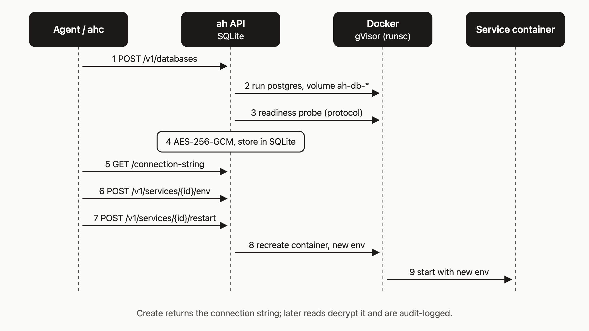

# Add a Postgres database to your service

Your app works until it needs to remember something. Then it needs a real database, and I think an agent should be able to create one with a single API call instead of you running `docker run postgres` by hand on a box you are trying to keep locked down.

By the end of this tutorial you will have a managed Postgres container, its connection string stored as `DATABASE_URL` on your service, and the service restarted so it picks that variable up. I show it three ways: raw API calls so you can see each step, one `ahc` command, and one slash command in Claude Code.

Note: the commands below were checked against the agentic-hosting source, not run end to end for this post. The last section lists one thing the code does not settle.



## Prerequisites

- An agentic-hosting account and API key. The hosted API is `https://api.agentic.hosting/v1/`. If you self-host, use your own host.
- A deployed service. You need its ID (or its name, for the `ahc` path).
- `curl` and `python3` for the raw API steps.

```bash
export AH_URL="https://api.agentic.hosting"
export AH_KEY="<your-api-key>"
```

`ahc` reads the same `AH_URL` and `AH_KEY` variables. It also accepts `--url` and `--key` flags.

Find your service ID:

```bash
curl -s -H "Authorization: Bearer $AH_KEY" "$AH_URL/v1/services"
export SERVICE_ID="<id-from-the-list>"
```

## Step 1: Create the database

```bash
curl -s -X POST "$AH_URL/v1/databases" \
  -H "Authorization: Bearer $AH_KEY" \
  -H "Content-Type: application/json" \
  -H "Idempotency-Key: $(uuidgen)" \
  -d '{"name":"my-app-db","type":"postgres"}'
```

`type` is `postgres` or `redis`. The name is 1 to 63 characters, starts with a letter, and may contain letters, digits, hyphens, and underscores. It cannot end with a hyphen.

Use an `Idempotency-Key`. This call is slow, and if your client times out and retries with the same key, the server replays the original response (marked with an `Idempotency-Replayed: true` header) instead of provisioning a second database.

It takes up to about 30 seconds once the image is local. The server pulls `postgres:16-alpine` first, which can take longer on a cold host, and the route allows up to six minutes in total. Then it waits up to 30 seconds for Postgres to be ready. That check speaks the Postgres protocol; a plain open TCP port is not enough.

A success returns `201` with a JSON body shaped like this:

```json
{
  "id": "<32-char-hex-id>",
  "name": "my-app-db",
  "type": "postgres",
  "status": "ready",
  "host": "127.0.0.1",
  "port": 5xxx,
  "db_name": "ah",
  "username": "ah",
  "connection_string": "postgres://ah:<password>@127.0.0.1:<port>/ah?sslmode=disable",
  "created_at": 0,
  "updated_at": 0
}
```

Save the `id` as `DB_ID`. The values above are placeholders; yours will differ.

## Step 2: Fetch the connection string

```bash
CONN=$(curl -s -H "Authorization: Bearer $AH_KEY" \
  "$AH_URL/v1/databases/$DB_ID/connection-string" \
  | python3 -c 'import sys,json; print(json.load(sys.stdin)["connection_string"])')
```

The response is `{"connection_string":"..."}`. The server decrypts the stored value for this call and writes an audit log line (`database.connection_string_accessed`) with your tenant, the database ID, and the API key ID. A plain `GET /v1/databases/$DB_ID` does not decrypt anything, so use that one for status checks.

Do not `echo $CONN`. The string contains the database password.

## Step 3: Set DATABASE_URL and restart

```bash
curl -s -X POST "$AH_URL/v1/services/$SERVICE_ID/env" \
  -H "Authorization: Bearer $AH_KEY" \
  -H "Content-Type: application/json" \
  -d "{\"DATABASE_URL\":\"$CONN\"}"

curl -s -X POST "$AH_URL/v1/services/$SERVICE_ID/restart" \
  -H "Authorization: Bearer $AH_KEY"
```

The env call returns `{"status":"updated","note":"restart will recreate the container with the new env vars"}`. The restart returns `{"status":"running"}`.

Do not skip the restart. A running container keeps the environment it started with, and a restart recreates the container, which is when `DATABASE_URL` takes effect. The platform does not inject the variable for you, so this step is yours (or `ahc`'s, below).

## Step 4: Do all of it with one command

```bash
ahc db provision my-app postgres
```

`my-app` is the service name. The command resolves the ID, creates a database named `my-app-postgres` (change it with `--name`), waits until the status is `ready`, fetches the connection string, sets `DATABASE_URL` on the service, and restarts it. Output looks like this:

```text
Provisioning postgres database "my-app-postgres"...
Database "my-app-postgres" created (id: <id>)
Waiting for database to become available done.
Setting DATABASE_URL on service "my-app"...
Restarting service "my-app"...
Done. my-app-postgres is ready. Connection host: postgres://127.0.0.1:<port>
```

The last line prints only the scheme, host, and port. The password is never shown. With `--json`, progress goes to stderr and stdout carries the database record.

## Step 5: The same thing in Claude Code

The repo ships a slash command, `/ah-db`:

```text
/ah-db my-app postgres
```

It finds the service by name, creates the database with an idempotency key, polls until the database is up, fetches the connection string, sets `DATABASE_URL`, restarts the service, and polls the service. It uses `$AH_URL` and `$AH_KEY` from your environment. Its instructions tell the agent to report only the host and port, never the full string.

## How it works

Follow the diagram top to bottom.

1. `POST /v1/databases` reaches the ah API. It checks the type and name, checks disk space, and pulls the image.
2. The API checks your quota and inserts a `provisioning` row, then asks Docker to create a volume named `ah-db-<id>` and start Postgres under gVisor (`runsc`). The container publishes its port on the host's `127.0.0.1` only.
3. The API probes Postgres until it answers at the protocol level, then marks the row `ready`.
4. The password and the full connection string are encrypted with AES-256-GCM using the server master key and stored in SQLite.
5. `GET .../connection-string` decrypts and returns the string, and logs the access.
6. `POST .../env` stores the variable on the service.
7. `POST .../restart` recreates the service container with the new environment.

## Cleanup, limits, and handling the string

- **Deleting.** `ahc db delete my-app-postgres --confirm` (or `DELETE /v1/databases/{id}`, which returns `204`) removes the container and wipes and removes the volume. There is no undo. Deleting does not touch the service's `DATABASE_URL`, so remove or replace it before the service restarts again.
- **Quota.** The default is 3 databases per tenant. Rows with status `failed` do not count. The fourth create returns `409` with `quota exceeded: maximum 3 databases reached`.
- **Secrets.** Only echo the host and port back to a user, a log, or another agent. Treat the full string like a password. Each read is audit-logged, so fetch it when you need it and avoid caching it in chat transcripts.

## One thing to check on your deployment

The connection string host is `127.0.0.1`, and the database port is bound to the host's loopback interface. Service containers run on a per-tenant Docker network. I could not confirm from the code that a service container can reach that address, so verify it on your deployment: after the restart, check your service logs for a successful database connection before you rely on it. If it cannot connect, the [troubleshooting page](https://agentic.hosting/docs/troubleshooting/) is the place to start.

## What to try next

- Read the [Postgres and Redis reference](https://agentic.hosting/docs/databases/).
- Learn how [environment variables](https://agentic.hosting/docs/env/) behave on a service.
- See how [backups](https://agentic.hosting/docs/backups/) work.
- Read the [security model](https://agentic.hosting/docs/security/) for how secrets are stored.
- Set up [Claude Code](https://agentic.hosting/docs/claude-code/) and try `/ah-db`.
- Browse the code: [github.com/dennisonbertram/agentic-hosting](https://github.com/dennisonbertram/agentic-hosting).
