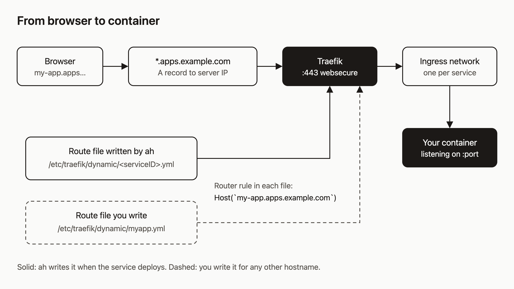

# Give your services real URLs with a base domain and wildcard DNS

You deployed a service and the URL looks like `http://3f2a9c….localhost`. That works on the server and nowhere else. You own a domain, and you want `https://my-app.apps.example.com`.

I think this is the right place to spend ten minutes early. An agent that creates services needs each one to get a public URL without anyone touching DNS again.

By the end you will have one wildcard DNS record and one startup flag. After that, every service you create gets its own HTTPS hostname with no per-service setup. You will also have a hand-written Traefik file for any hostname that does not fit the wildcard.



I checked every command below against the code. I did not run them for this post, so treat the output samples as shapes, not captured logs.

## Prerequisites

- A running `ah` server with Traefik using the file provider. `docs/ops/fresh-install.md` in the repo covers `scripts/bootstrap-stack.sh`.
- A domain where you can add DNS records.
- Ports 80 and 443 open to the server. Let's Encrypt needs port 80 for issuance.
- An API key, shown here as `$AH_API_KEY`. Self-hosted readers use their own host in place of the public API, `https://api.agentic.hosting/v1/`.

## The two URL modes

`ah` has two modes, and the flag decides which one you get.

| Start `ah` with | Service URL |
|---|---|
| no `--base-domain` | `http://<service-id>.localhost` (not public) |
| `--base-domain apps.example.com` | `https://<dns_label>.apps.example.com` |

## Step 1: Add the wildcard record and start ah with the flag

At your DNS provider, add one record:

```
*.apps.example.com   A   <your server IPv4>
```

Then start the daemon with the base domain. You can use the flag or the environment variable:

```bash
ah --base-domain apps.example.com
# or
AH_BASE_DOMAIN=apps.example.com ah
```

Give it a bare domain. `ah` exits at startup if the value contains `://` or is not a lowercase DNS name. If you already ran the bootstrap script, set the flag wherever your unit starts `ah`.

## Step 2: Create a service and predict its URL

The label comes from the service name: lowercase it, turn every character that is not a letter or digit into a hyphen, then trim hyphens from the ends. `My Blog App` becomes `my-blog-app`.

```bash
curl -s -X POST https://api.agentic.hosting/v1/services \
  -H "Authorization: Bearer $AH_API_KEY" \
  -H "Content-Type: application/json" \
  -d '{"name":"My Blog App","image":"nginx:latest","port":80}'
```

Or with the CLI:

```bash
ahc service create --name "My Blog App" --image nginx:latest --port 80
```

The API returns `201` right away and deploys in the background. The body includes these fields:

```json
{
  "id": "…",
  "name": "My Blog App",
  "dns_label": "my-blog-app",
  "status": "deploying",
  "url": "https://my-blog-app.apps.example.com"
}
```

Once the status settles, open the `url`. `ah` wrote a route file into `/etc/traefik/dynamic/` (named `<serviceID>.yml`) and Traefik picked it up.

## Step 3: Three ways creation fails

With a base domain set, the name has to produce a usable label. There are three failures. The status codes below come from the code. Some older notes in the repo say 422, but the code returns 400 and 409.

1. **Reserved label, `400`.** You cannot claim `api`, `admin`, `dashboard`, `traefik`, `www`, `mail`, `smtp`, `health`, `status`, `metrics`, `grafana`, `prometheus`, `registry`, `auth`, `login`, or `oauth`. Names starting with `env-` are also reserved, because environment previews use them.
2. **Label over 63 characters, `400`.** DNS labels cap at 63. The error says the name is too long for DNS routing. A name with no letters or digits fails too.
3. **Label already taken, `409`.** Labels are first come, first served across all tenants. The error reads `subdomain already taken: <label> — choose a different service name`.

Errors come back as `{"error": "..."}`. The fix is always a different name, such as `myapp-api` instead of `api`. An agent can read that error and retry on its own.

## Step 4: What stays fixed

`dns_label` is stored when you create the service. Restarting `ah`, stopping and starting the service, or changing or removing `--base-domain` does not change the stored label. The repo docs say the same.

One thing does change it: renaming. `PATCH /v1/services/{id}` with a new `name` (or `ahc service rename`) re-derives the label, checks it against the same rules, and rewrites the route file. If you need a stable URL, do not rename the service.

The `url` field is also stored. `ah` rewrites it when a service is created, deployed, or renamed, so dropping `--base-domain` does not rewrite the URLs of existing services. They keep returning the old `https://` URL until the next deploy or rename, and the route file for the old hostname stays in place until then.

## Step 5: Route any other hostname by hand

The wildcard only covers `<label>.apps.example.com`. For something like `blog.example.org`, point its A record at the server and write a Traefik file. Traefik watches `/etc/traefik/dynamic/` and reloads without a restart. This is based on `deploy/traefik/dynamic-site-template.yml`:

```yaml
http:
  routers:
    myapp-http:
      rule: "Host(`blog.example.org`)"
      entryPoints: [web]
      middlewares: [myapp-redirect-https]
      service: myapp-svc
    myapp:
      rule: "Host(`blog.example.org`)"
      entryPoints: [websecure]
      service: myapp-svc
      tls:
        certResolver: letsencrypt
  middlewares:
    myapp-redirect-https:
      redirectScheme:
        scheme: https
        permanent: true
  services:
    myapp-svc:
      loadBalancer:
        servers:
          - url: "http://<container-name>:80"
```

Use a name, not an IP, so the route survives restarts. For the target, the container is named `ah-<tenantID>-<serviceID>`, and `ah` itself routes to the alias `ah-route-service-<serviceID>` on the service's ingress network. I have not tested which of the two resolves best for a hand-written file on your setup, so check with a request. Replace `80` with your service's port.

## Step 6: TLS

Traefik asks Let's Encrypt for a certificate per hostname the first time someone requests it. Expect the first request to take several seconds. The repo notes say 5 to 10 seconds. If you expect many services, remember Let's Encrypt rate limits apply per hostname; the repo suggests a wildcard certificate for high volume, but this post does not set that up.

## How it works

Follow the diagram left to right. The browser resolves `my-app.apps.example.com` through your wildcard record to the server IP. Traefik listens on `:443` and matches the request against router rules loaded from `/etc/traefik/dynamic/`. The rule `Host(`my-app.apps.example.com`)` comes from the file `ah` wrote when the service deployed. Traefik then forwards over a bridge network that exists only for that service and Traefik, to the container on its port.

The dashed path is the same, except you wrote the file. Traefik does not care who wrote it.

## What to try next

- [Deploy docs](https://agentic.hosting/docs/deploy/) for the URL table and build options.
- [Troubleshooting](https://agentic.hosting/docs/troubleshooting/) if a route does not answer.
- [Architecture](https://agentic.hosting/docs/architecture/) for how ingress networks isolate services.
- Source and issues: [github.com/dennisonbertram/agentic-hosting](https://github.com/dennisonbertram/agentic-hosting).
