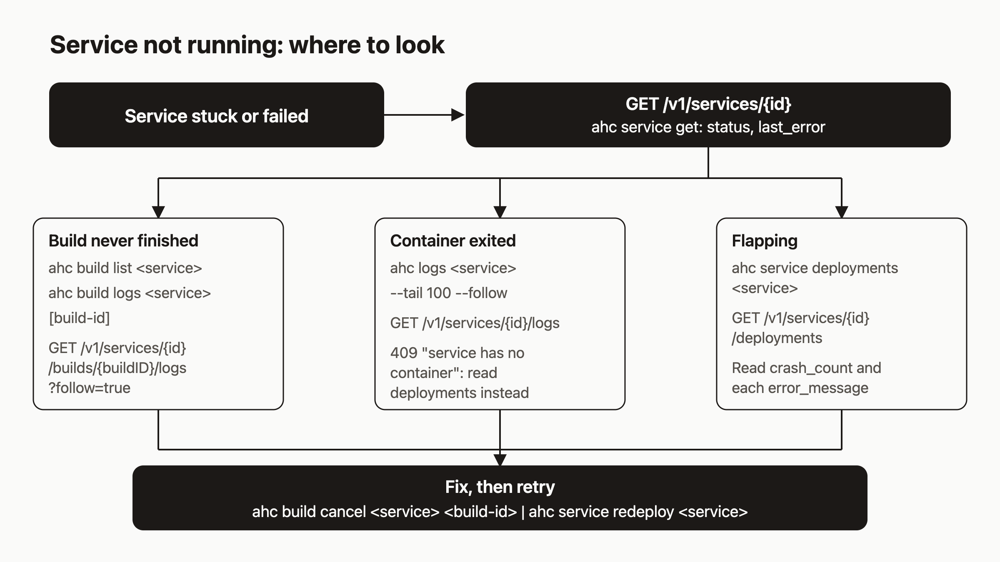

# Find out why a deploy failed: logs, builds and deployment history

Your service says `deploying` for ten minutes, or it says `failed`, and you do not know why. The answer is almost always already recorded somewhere. The hard part is knowing which of four places to look in. I think this matters most for AI agents: an agent that follows a fixed order reads the evidence once, while one that guesses burns tokens on redeploys that fix nothing.

By the end you will have a short routine to run every time: five read commands in a fixed order, plus two ways to get unstuck. It works the same for you and for an AI agent running `ahc` or calling the API.



## Prerequisites

- A running agentic-hosting instance and an API key. On the hosted service the API base is `https://api.agentic.hosting/v1/`. If you self-host, use your own host.
- The `ahc` CLI, configured with `ahc configure --url <URL> --key <KEY>`. You can also set `AH_URL` and `AH_KEY`.
- For the curl examples, `export AH_KEY=...` and `export AH_URL=https://api.agentic.hosting`.

I checked these commands against the code. I did not run them for this post, so the sample output below shows the shape of the response, not captured output.

## Step 1: Break a deploy on purpose

Practice on something you broke yourself. The easiest failure is an image tag that does not exist:

```bash
ahc service create --name broken --image nginx:this-tag-does-not-exist --port 80
```

Or with curl:

```bash
curl -s -X POST "$AH_URL/v1/services" \
  -H "Authorization: Bearer $AH_KEY" \
  -H "Content-Type: application/json" \
  -d '{"name":"broken","image":"nginx:this-tag-does-not-exist","port":80}'
```

The create call returns `201` with the service. The deploy itself runs afterward, so the failure shows up a moment later, not in the create response.

## Step 2: Read status and last_error

This is command one. Always start here.

```bash
ahc service get broken
```

```text
ID:            <32-character hex id>
Name:          broken
Status:        failed
Image:         nginx:this-tag-does-not-exist
...
Restarts:      0
Circuit Open:  false
Last Error:    image pull failed: ...
```

The same data over the API:

```bash
curl -s -H "Authorization: Bearer $AH_KEY" "$AH_URL/v1/services/$SERVICE_ID"
```

Two fields matter: `status` and `last_error`. Valid statuses in the code are `created`, `running`, `stopped`, `deploying`, `failed`, `error`, `crashed` and `restarting` (set during a restart). Do not treat this list as exhaustive. When the pull fails, `last_error` starts with `image pull failed:`. A failed network setup says `network setup failed:`. If the message is clear, you may be done here.

The CLI accepts a service name or the 32-character hex ID. The API paths take the ID.

## Step 3: Read the build output

If the service comes from a git build and never reached `running`, look at the build.

```bash
ahc build list my-api
ahc build logs my-api            # latest build
ahc build logs my-api <build-id> # a specific build
```

`build list` prints a table with ID (first 8 characters), status, git URL, branch and created time. Use `--json` for full IDs, or `--all` for every build in your tenant. `build logs` always asks the server to follow. For a build that is still `pending` or `running`, it prints what exists and stays open until the build finishes, or until you press Ctrl-C. For a finished build it prints the stored log and exits.

The API route is `GET /v1/services/{id}/builds/{buildID}/logs`. Without `follow=true` you get the whole stored log as plain text. With it, you get the stored log first and then new lines as they arrive:

```bash
curl -N -H "Authorization: Bearer $AH_KEY" \
  "$AH_URL/v1/services/$SERVICE_ID/builds/$BUILD_ID/logs?follow=true"
```

A build that is still `pending` or `running` can be cancelled. A finished build cannot (see step 6).

## Step 4: Read the runtime output

If the build succeeded but the container died, read the container's own output:

```bash
ahc logs my-api --tail 100 --follow
```

`--tail` defaults to 100. `--follow` keeps the stream open. The API equivalent:

```bash
curl -N -H "Authorization: Bearer $AH_KEY" \
  "$AH_URL/v1/services/$SERVICE_ID/logs?tail=100&follow=true"
```

The server accepts `tail` from 1 to 10000. A value outside that range, or one that is not a number, silently falls back to 100.

If the service has no container, you get `409` with `service has no container`. That happens after a circuit break, when the container is stopped and removed, and after a deploy that never created one. A 409 here is information: skip to step 5.

## Step 5: Read the deployment history

Each deploy attempt is recorded. When a service flaps, this is where you see the pattern.

```bash
ahc service deployments my-api
```

```text
ID        STATUS   TRIGGER  IMAGE                       STARTED
a1b2c3d4  failed   build    127.0.0.1:5000/ah/...       2026-01-01 12:00:00
```

Use `--json` for full records, or call `GET /v1/services/{id}/deployments`. Each record has `status`, `trigger`, `image`, `error_message`, `build_id` and timestamps. Statuses are `pending`, `deploying`, `running`, `failed`, `crashed`, `stopped` and `cancelled`. Triggers are `manual`, `build`, `restart`, `reconciler` and `auto_recovery`.

Combine this with `crash_count` and `circuit_open` from step 2. Five exits or failed health checks within 10 minutes opens the circuit and the container is removed, per the troubleshooting page. A trigger of `reconciler` or `auto_recovery` tells you the platform acted, not you.

## Step 6: Cancel and redeploy

To stop a build in progress:

```bash
ahc build cancel my-api <build-id>
```

This works only on a `pending` or `running` build. Anything else returns `409`. The API route is `DELETE /v1/services/{id}/builds/{buildID}`.

To cancel a deployment, use the API. There is no `ahc` command for it:

```bash
curl -s -X POST -H "Authorization: Bearer $AH_KEY" \
  "$AH_URL/v1/services/$SERVICE_ID/deployments/$DEPLOYMENT_ID/cancel"
```

Only a deployment with status `pending` can be cancelled. Cancelling it also tries to cancel its build.

Once you have fixed the cause, recreate the container with the stored image and env:

```bash
ahc service redeploy my-api
```

`redeploy` does not run a new build. If the cause was in your code, push a fix and start a new build. If the circuit is open, the troubleshooting page says to `reset` first and then `redeploy`, not `start`.

## How it works

Everything starts at the service record, because it carries `status` and `last_error`. Those fields point to one of three places that hold the evidence, as the diagram shows:

- **The build never finished.** Build logs are stored per build, so you can read them after the fact.
- **The container ran and exited.** The runtime logs come straight from the container, so they exist only while the container exists. That is why you get the 409.
- **The service keeps coming back and dying.** Each attempt writes a deployment record, so the history shows the pattern even when no container is left.

## Limits to know about

- **Build logs are bounded.** The cap is 5 MB per build. Past that, the stored log is replaced with a notice, `[truncated: N lines omitted, 5MB limit reached]`, followed by the last 500 lines. If your early build output is missing, this is why.
- **Stuck deploys get marked failed.** The reconciler marks any service in `deploying` for more than 10 minutes as `failed` with `last_error` set to `deploy timed out (reconciler)`, and records a deployment event. If you see that string, the deploy hung rather than failing loudly.
- **Streams and timeouts.** The troubleshooting page says log streams die at about 30 seconds. The changelog says the server-wide write timeout was removed, and the server code sets none. Streaming routes use a 60-second idle write deadline that renews on every write. So a stream that is producing output should stay open, and one that stalls for 60 seconds may be cut. I have not tested a `follow=true` stream past 60 seconds against a live server, so treat the 30-second claim as unconfirmed and reconnect if a stream drops.

## What to try next

- Read the [troubleshooting guide](https://agentic.hosting/docs/troubleshooting) for circuit-open recovery and disk errors.
- Read [reconciliation](https://agentic.hosting/docs/reconciliation) to see what the background loop changes on your behalf.
- Read [deploy](https://agentic.hosting/docs/deploy) and the [API reference](https://agentic.hosting/docs/api) for the full list of routes.
- Star or file an issue on [the GitHub repo](https://github.com/dennisonbertram/agentic-hosting) if a command here does not behave as described.
