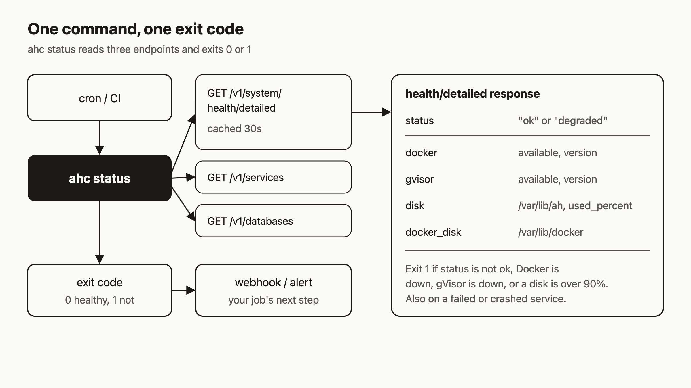

# Monitor your server from CI and cron with ahc status

I think the best monitoring for a small server is one command that tells you when something is wrong. A dashboard only helps if you remember to open it. A command that exits 0 when things are fine and 1 when they are not lets cron or CI do the watching for you.

`ahc status` is that command. By the end of this post you will have a scheduled check that fails when health, Docker, a disk or any service is unhealthy, and sends a webhook when it does. You will also have made it fail on purpose, which I think matters most.



## Prerequisites

- A running agentic-hosting server and an API key. The public API is `https://api.agentic.hosting/v1/`. If you self-host, use your own host.
- The `ahc` CLI. The install guide shows `curl -fsSL https://agentic.hosting/install-cli.sh | bash`.
- Shell access to the machine that will run the check (a CI runner or any box with cron).

I checked these commands against the code. I did not run them for this post, so treat the output samples below as shapes, not captured logs.

## 1. Run it once by hand

Point the CLI at your server. The `ahc configure` command takes `--url` and `--key`, and `ahc` also reads the `AH_URL` and `AH_KEY` environment variables.

```bash
export AH_URL="https://api.agentic.hosting"
export AH_KEY="$AH_API_KEY"   # your tenant API key
ahc status
```

You get three blocks: system health, a services table, a databases table. Roughly:

```text
System Health
-------------
  Status:  ok
  Disk:    42.0%
  Docker:  <version>
  gVisor:  available

Services
NAME   STATUS    RESTARTS
...

Databases
NAME   TYPE   STATUS
...
```

The disk line turns yellow above 80% and red above 90%. The `RESTARTS` column is the service's `crash_count`.

For scripts, ask for JSON:

```bash
ahc status --json
```

That prints one object with three keys: `health`, `services` and `databases`. The `health` object has `status`, `docker`, `gvisor`, `disk` and `docker_disk`. `disk` is the filesystem holding the data directory (`/var/lib/ah` by default). `docker_disk` is `/var/lib/docker`. Each disk reports `total_gb`, `free_gb` and `used_percent`. The server may also add `docker_storage` and `traefik_networks`.

## 2. Know what makes it exit 1

`ahc status` exits 1 when any of these is true:

- Health `status` is not `ok`. The server sets `degraded` when its database ping fails, when either disk is over 90%, or when more than 200 tenant networks are attached.
- Docker is unavailable.
- gVisor is unavailable.
- `disk` or `docker_disk` is over 90% used.
- A service has `status` of `failed`, `crashed` or `error`, or has `circuit_open` set to true.
- A database has status `failed` or `error`.

Two details from the code. The built-in `--help` text lists only some of these, but the code also checks gVisor and database status. And if the CLI cannot reach the API at all, it prints an error and exits 1, so a dead server also fails your check.

## 3. Understand the cache before you poll

The first read is `GET /v1/system/health/detailed`. It needs your API key. The server caches the result for 30 seconds, because the probe runs `docker version`, `runsc --version` and disk checks.

```bash
curl -s -H "Authorization: Bearer $AH_API_KEY" \
  https://api.agentic.hosting/v1/system/health/detailed

# Accept a result up to 10 seconds old instead of 30:
curl -s -H "Authorization: Bearer $AH_API_KEY" \
  "https://api.agentic.hosting/v1/system/health/detailed?fresh=true"
```

`?fresh=true` does not force a probe. It shortens the accepted age from 30 seconds to 10, so the server runs at most one live probe per 10 seconds, however many callers ask. Polling more often than every 30 seconds gains you little.

There is also an unauthenticated `GET /v1/system/health` that returns only `{"status":"ok"}`. It is a liveness check. It does not tell you about Docker, disks or services.

## 4. Schedule it

### Cron

```cron
*/5 * * * * AH_URL="https://api.agentic.hosting" AH_KEY="$AH_API_KEY" ahc status >/dev/null || curl -s -X POST -H "Content-Type: application/json" -d '{"text":"ahc status failed"}' "$ALERT_WEBHOOK_URL"
```

Cron does not expand your shell's variables, so put the real values in the crontab's environment lines or a wrapper script. The webhook body here is a placeholder. Use whatever shape your chat or paging tool expects.

### GitHub Actions

Store `AH_URL`, `AH_KEY` and `ALERT_WEBHOOK_URL` as repository secrets.

```yaml
name: server-check
on:
  schedule:
    - cron: "*/15 * * * *"
  workflow_dispatch:
jobs:
  status:
    runs-on: ubuntu-latest
    steps:
      - name: Install ahc
        run: curl -fsSL https://agentic.hosting/install-cli.sh | bash
      - name: Check server
        env:
          AH_URL: ${{ secrets.AH_URL }}
          AH_KEY: ${{ secrets.AH_KEY }}
        run: ahc status --json > status.json
      - name: Alert
        if: failure()
        run: |
          curl -s -X POST -H "Content-Type: application/json" \
            -d '{"text":"agentic-hosting status check failed"}' \
            "${{ secrets.ALERT_WEBHOOK_URL }}"
      - uses: actions/upload-artifact@v4
        if: always()
        with:
          name: status
          path: status.json
```

The `ahc status` step fails the job on exit 1, and `if: failure()` fires the webhook. Check where the installer puts `ahc` and that it is on `PATH` for later steps. I did not verify that part. Also note that scheduled GitHub workflows can be delayed, so use cron on a box you own if you need tight timing.

## 5. Add the server-side script

`ahc status` asks the API. It cannot see a dead API process, a stopped systemd unit or missing infrastructure containers. For that, the repo ships `scripts/health-check.sh`. It runs five checks and exits 0 or 1:

1. `GET /v1/system/health` on `127.0.0.1` returns `{"status":"ok"}`.
2. `systemctl is-active ah` says `active`.
3. `docker ps` lists `paas-traefik` and `paas-registry`.
4. Disk usage for the data and Docker directories: warn at 80%, fail at 90%.
5. If `AH_BASE_DOMAIN` is set, the public HTTPS URL returns 2xx or 3xx.

Try it without sending anything:

```bash
ALERT_WEBHOOK_URL="https://hooks.example.com/alert" ./scripts/health-check.sh --dry-run
```

On failure (without `--dry-run`) it POSTs JSON to `ALERT_WEBHOOK_URL` with these fields: `event` (`health_check_failed`), `hostname`, `timestamp`, `failure_count`, `warning_count`, `failures` and `warnings`. Warnings never change the exit code. Other settings are `AH_API_PORT` (default 8080), `AH_SERVICE_NAME`, `AH_DATA_DIR`, `AH_DOCKER_DATA_DIR`, `AH_DISK_WARN_PCT` and `AH_DISK_FAIL_PCT`.

One thing to check before you rely on it. The install guide says the server rejects loopback requests to the API unless they carry `X-Forwarded-Proto: https`, and its own example health check sets that header. Reading the script, its first check calls `curl` without that header. On a production host that would likely get HTTP 403 and fail check 1. I have not run it, so test with `--dry-run` first. If you see the 403, add the header to the script's two `curl` calls.

Cron entry from `scripts/README.md`:

```cron
*/5 * * * * ALERT_WEBHOOK_URL="https://hooks.example.com/alert" AH_BASE_DOMAIN="agentic.hosting" /opt/agentic-hosting/scripts/health-check.sh >> /var/log/ah-health.log 2>&1
```

I would run both: `ahc status` for what is running, the script for the host it runs on.

## 6. Make it fail on purpose

A check you have never seen fail is a guess, so I like to break something on purpose. On a test service, find its container and stop it:

```bash
docker ps --format '{{.Names}}'
docker stop <container-name>
```

Do this on a throwaway service, not production. The reconciler runs every 30 seconds. Per the reconciliation docs, it treats an exited container on a `running` service as a crash. Wait a tick or two, then:

```bash
ahc status; echo "exit=$?"
```

You should see the service as `crashed` and `exit=1`. If it keeps crashing, five crashes inside a 600-second window open the circuit breaker. The service then shows `crashed (circuit open)` and `circuit_open` is true. The breaker clears itself later but leaves the service `stopped`, so run a redeploy (`POST /v1/services/{serviceID}/redeploy`) once the app is fixed. Both states make `ahc status` exit 1.

## How it works

Look at the diagram. Cron or CI starts `ahc status`. The CLI makes three reads in order: `/v1/system/health/detailed`, `/v1/services` and `/v1/databases`. It combines them, applies the rules from step 2, prints a table or JSON, and exits. Your scheduler sees only the exit code.

On the right is the health response. The server builds it by running `docker version`, `runsc --version`, a filesystem stat of the data directory and of `/var/lib/docker`, and a ping of its own state database. The `status` field is `ok` unless the state database ping fails, either disk is over 90%, or more than 200 tenant networks are attached; then it is `degraded`. A missing Docker or gVisor does not change `status`. It only sets that block's `available` to false, which `ahc status` checks separately.

## What to try next

- Read how crashes, the circuit breaker and recovery work: [Reconciliation](https://agentic.hosting/docs/reconciliation/) and [Crash-loop and disk guards](https://agentic.hosting/docs/guards/).
- Fix common problems: [Troubleshooting](https://agentic.hosting/docs/troubleshooting/).
- Set up the server and the CLI: [Install](https://agentic.hosting/docs/install/).
- Read the source: [github.com/dennisonbertram/agentic-hosting](https://github.com/dennisonbertram/agentic-hosting).
