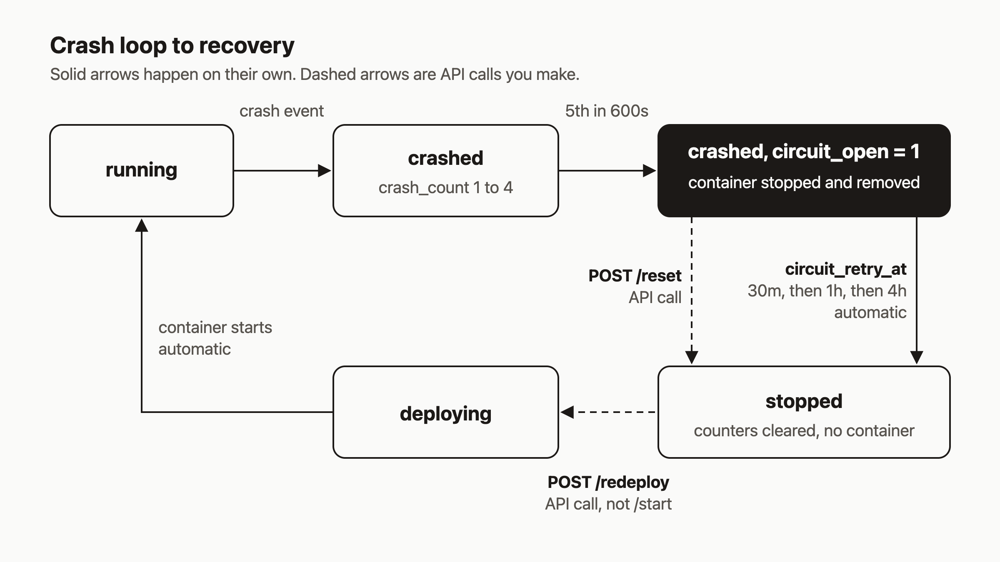

Sooner or later you deploy something that falls over on start. A missing env var, a bad image tag, a port that is already taken. The container exits, the platform restarts it, it exits again. If nothing stops that, you get a restart storm that burns CPU and fills logs for nobody.

agentic-hosting stops it with a circuit breaker. I like that default, but the breaker behaves in a few ways that surprise people (and agents) the first time. By the end of this post you will know how to read the breaker's state, find the cause, and bring the service back with `reset` followed by `redeploy`.



I checked the commands below against the source code. I did not run them for this post, so treat the output shapes as shapes, not captured output.

## Prerequisites

- A running agentic-hosting server and an API key. The hosted API is `https://api.agentic.hosting/v1/`; if you self-host, use your own host.
- `curl` and `jq`, or the `ahc` CLI configured with `ahc configure --url "$AH_URL" --key "$AH_KEY"`.

```bash
export AH_URL="https://api.agentic.hosting"
export AH_API_KEY="keyid.secret"   # placeholder, use your own key
```

## 1. Deploy an app that exits immediately

Any image whose main process exits at start will do. For a quick test, a bare `alpine:3.20` with no command should exit right away. Port is optional (0 means the default).

```bash
curl -s -X POST "$AH_URL/v1/services" \
  -H "Authorization: Bearer $AH_API_KEY" \
  -H "Content-Type: application/json" \
  -d '{"name":"flaky","image":"alpine:3.20"}'
```

The response is `201` with the service object and `"status":"deploying"`. The deploy itself runs in the background. The CLI equivalent is:

```bash
ahc service create --name flaky --image alpine:3.20
```

Containers run with Docker's `unless-stopped` restart policy, so Docker restarts the crashed container on its own. The reconciler mostly watches, counts crashes, and decides when to give up. The one restart it does itself is for a container that is running but reports unhealthy, because Docker's policy would not restart that one.

## 2. Watch the crash count climb

```bash
SERVICE_ID=...   # the "id" from the create response
curl -s -H "Authorization: Bearer $AH_API_KEY" "$AH_URL/v1/services/$SERVICE_ID" \
  | jq '{status, crash_count, circuit_open, last_error}'
```

Expect something shaped like this while the loop runs:

```json
{
  "status": "crashed",
  "crash_count": 3,
  "circuit_open": false,
  "last_error": "container restarted 1 time(s) by Docker (state restarting, exit code 0)"
}
```

The reconciler counts a crash event when Docker's restart count grows, when a running service's container is exited or gone, or when a health check reports unhealthy. Crashes are counted inside a 600-second window. When `crash_count` reaches 5 inside that window, the breaker opens.

With the CLI, `ahc service get flaky` prints the same fields. Note that it labels `crash_count` as "Restarts".

## 3. The quirks after the breaker opens

Fetch the service again once it trips:

```json
{
  "status": "crashed",
  "crash_count": 5,
  "circuit_open": true,
  "last_error": "container exited (exit code 0)"
}
```

Three things to know:

1. **`status` stays `crashed`.** It is never the string `"circuit_open"`. The breaker is a separate boolean, `circuit_open`. Check both fields.
2. **The container is gone.** When the breaker opens, the platform stops and removes the container and clears `container_id`. There is nothing left to inspect.
3. **Logs return 409.** `GET /v1/services/{id}/logs` answers `409` with `service has no container`. Read your logs before the fifth crash if you can, or use the deployment history below.

## 4. Read the cause

Two places have it. First, `last_error` on the service. Capture it now, because a manual reset clears it (the reset sets `last_error` to an empty string).

```bash
curl -s -H "Authorization: Bearer $AH_API_KEY" "$AH_URL/v1/services/$SERVICE_ID/deployments" \
  | jq '.[] | {id, status, trigger, error_message, started_at}'
```

Second, the deployment history. Each crash the reconciler sees is recorded as a deployment with status `crashed` and the reason in `error_message`. The CLI version is `ahc service deployments flaky`.

If the reason is vague, such as an exit code with no message, the cause is in your app. Run the image locally or add startup logging, then deploy again.

## 5. Fix it, then reset and redeploy

Say the cause was a missing env var. Set it. The env endpoint takes a JSON object of keys and values:

```bash
curl -s -X POST "$AH_URL/v1/services/$SERVICE_ID/env" \
  -H "Authorization: Bearer $AH_API_KEY" \
  -H "Content-Type: application/json" \
  -d '{"DATABASE_URL":"postgres://..."}'
```

Once the cause is fixed, bring the service back in two calls:

```bash
curl -s -X POST -H "Authorization: Bearer $AH_API_KEY" "$AH_URL/v1/services/$SERVICE_ID/reset"
curl -s -X POST -H "Authorization: Bearer $AH_API_KEY" "$AH_URL/v1/services/$SERVICE_ID/redeploy"
```

`reset` returns `{"status":"circuit breaker reset"}`. It clears `crash_count`, sets `circuit_open` to false, sets `status` to `stopped`, and makes sure no container remains. `redeploy` creates a new container from the current image and env and returns the updated service object.

Do not call `/start` here. Reset cleared the container ID, so start has nothing to start and returns `409`. Redeploy is the call that creates a container.

With the CLI:

```bash
ahc service reset flaky
ahc service redeploy flaky
```

`reset` prints `Circuit breaker reset.` and `redeploy` prints `Service "flaky" redeployed (status: ...)`.

## 6. The automatic path

You do not have to reset. When the breaker opens it records a `circuit_retry_at` time. When that time passes, the reconciler closes the circuit and sets the service to `stopped`. It does not start it again.

The wait grows each time the same service trips:

| Time the breaker has opened | Wait before auto-recovery |
|---|---|
| 1st | 30 minutes |
| 2nd | 1 hour |
| 3rd and later | 4 hours |

After auto-recovery the service sits stopped until you redeploy. If you redeploy without fixing anything, it crash-loops, the breaker opens again, and the next wait is longer. The manual reset does not zero that open count (the reset query does not touch it), so resetting does not buy back a short wait.

## 7. The rule for agents

If an agent manages your services, give it this rule: **do not loop on reset.** I think this matters more for agents than for people, because an agent will happily retry forever. Reset means "I changed something that should fix the crash." Calling it repeatedly with no change only sends the service back through five more crashes. The docs say the same: do not script reset in a tight loop.

A safe agent routine looks like this:

1. Read `status`, `circuit_open`, `crash_count`, and `last_error`.
2. Read `/deployments` for the crash reasons.
3. Change the env or the image.
4. Call `reset` once, then `redeploy` once.
5. Read the service again. If `circuit_open` returns, stop and report to a human.

## How it works

Here is the diagram in words. A running service takes crash events and moves to `crashed` with a count of 1 to 4. Staying `crashed` is not final; if the container recovers and Docker reports it running and healthy, the reconciler moves the row back to `running`. The fifth crash inside 600 seconds sets `circuit_open = 1` and removes the container. Those steps happen on their own.

From there you have two exits. `POST /reset` is yours to call, and it lands in `stopped`. The `circuit_retry_at` timer is automatic and lands in the same place. Either way, the only way forward is `POST /redeploy`, which goes through `deploying` and back to `running`.

## What to try next

- Read the thresholds and backoff table in [Crash-loop and disk guards](https://agentic.hosting/docs/guards/).
- Keep the [troubleshooting page](https://agentic.hosting/docs/troubleshooting/) handy for the circuit-open checklist.
- See how the reconciler works in [Reconciliation](https://agentic.hosting/docs/reconciliation/) and the agent-facing notes in [For agents](https://agentic.hosting/docs/for-agents/).
- Read the code, including the reconciler's state machine comment, at [github.com/dennisonbertram/agentic-hosting](https://github.com/dennisonbertram/agentic-hosting).
