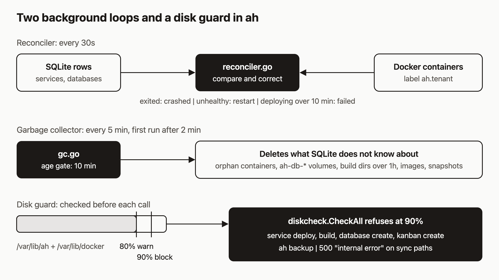

# Why docker stop is the wrong way to stop a service

You SSH into the host, see a container you do not like, and run `docker stop`. A minute later the service is marked `crashed` in the API and nothing you did seems to have registered. That is the reconciler doing its job.

I think a host that runs agents should correct drift on its own, because an agent will not notice a container that quietly disappeared. This post covers what `ah` does in the background, so you can predict what it does to a stray container, an orphan volume, or a disk that is almost full. Everything below comes from reading the source. I did not run these commands for this post, so treat the example output as the shape of the response, not a recording.



## Prerequisites

- A running `ah` server (self-hosted, or the public API at `https://api.agentic.hosting/v1/`).
- An API key in `$AH_API_KEY`, and a running service whose ID is in `$SERVICE_ID`.
- Shell access to the Docker host, only for the `docker stop` experiment in step 1.

## Step 1: stop a container the wrong way

`ah` keeps a SQLite row for every service and compares it with what Docker reports. Every 30 seconds the reconciler looks at each service whose status is `running` or `crashed`. If the row says `running` and Docker says the container is `exited`, that counts as a crash.

On the Docker host:

```sh
docker ps --filter label=ah.service --format '{{.ID}} {{.Names}}'
docker stop <container-id>
```

Wait up to 30 seconds, then ask the API:

```sh
curl -s -H "Authorization: Bearer $AH_API_KEY" \
  https://api.agentic.hosting/v1/services/$SERVICE_ID
```

Expect `"status": "crashed"`, `"crash_count": 1`, and a `last_error` like `container exited (exit code 0)` (the exit code depends on the app). A few details from the code:

- The reconciler records one crash event for this, not one per tick. Once the row is `crashed` and the container stays exited with no new restarts, it adds nothing more.
- It does not restart the container. The container runs with Docker's `unless-stopped` policy, so Docker will not bring a manually stopped container back either. The service just sits in `crashed`.
- Five crash events inside a 600-second window open the circuit breaker, which removes the container. One `docker stop` is nowhere near that, but a script that stops containers repeatedly could get there.
- If you `docker start` the container again, the next tick sees it running and healthy and moves the row back to `running`.

## Step 2: stop it properly

Use the API. It updates the row and stops the container together, so the reconciler has nothing to correct:

```sh
curl -s -X POST -H "Authorization: Bearer $AH_API_KEY" \
  https://api.agentic.hosting/v1/services/$SERVICE_ID/stop
```

```json
{"status":"stopped"}
```

With `ahc` it is `ahc service stop <name-or-id>`. The reconciler only scans `running` and `crashed` rows, so a `stopped` service is left alone.

## What else the reconciler does each tick

- **Unhealthy containers.** If the container is running but its health check reports `unhealthy`, `ah` counts a crash and restarts the container. (It does not add a health check for you. Health checks come from the image.)
- **Stale deploys.** A service stuck in `deploying` for more than 10 minutes is marked `failed` with `last_error` set to `deploy timed out (reconciler)`.
- **Missing containers.** A `running` service whose container Docker cannot find is marked `crashed`. A `ready` database in that situation becomes `unavailable`, and a `running` environment becomes `stopped`. Transient Docker errors are skipped, not counted.
- **Split-brain.** A container labeled `ah.service` whose ID differs from the one in the database gets a warning in the server log. The reconciler does not fix the row, because labels can be set by anyone with Docker access. Cleanup is left to the garbage collector.
- **Circuit recovery.** When a breaker's retry time passes, the service is reset to `stopped`. Nothing restarts it, so you redeploy it.

If Docker itself cannot be listed, the whole tick is skipped so a Docker outage does not rewrite your state.

## Step 3: know what the garbage collector deletes

The garbage collector runs every 5 minutes. The first run happens 2 minutes after the server starts. It deletes:

- Containers carrying `ah` labels (service, database, environment, kanban, warm-pool) that no database row references.
- `ah-db-*` volumes with no matching database row. It also checks `ah-env-*`, `ah-kanban-*` and `ah-pool-*` volumes the same way.
- Build directories older than 1 hour.
- Dangling images, plus unused tenant build and snapshot images.
- Orphaned tenant and ingress networks (these have a longer 15-minute age gate).
- Snapshots over the per-service count limit (`AH_SNAPSHOT_MAX_PER_SERVICE`, default 10) or the age limit (`AH_SNAPSHOT_MAX_AGE`, default 30 days).

A container must be at least 10 minutes old before it can be removed, so a deploy in flight is not mistaken for an orphan. If the database query fails, the collector skips that item rather than guessing.

So a stray container you start by hand with an `ah.service` label will survive about 10 to 15 minutes, then disappear. Most of the sweep is limited to `ah` labels and names, but two steps are not. The dangling-image prune and the unused anonymous volume prune run host-wide, with no ownership filter. If you share the Docker host with other workloads, GC can remove their dangling images and any anonymous volumes that no container is using. Named volumes are kept. I would run `ah` on a host it owns.

## Step 4: know what a full disk does

Before deploying a service, redeploying or restarting one, starting a build, creating a database, or creating a kanban, `ah` checks both `/var/lib/ah` and `/var/lib/docker`. At 80% used it writes a warning to the log and carries on. At 90% or more it refuses.

What the caller sees depends on the path:

- `POST /v1/services` still returns **201**. The deploy runs in the background, then the service goes to `failed` and `last_error` holds the disk message, something like `disk check: /var/lib/ah: insufficient disk space at /var/lib/ah (91.2% used, threshold 90%)`.
- Restart, redeploy, build, database and kanban creates return **503** with `{"error":"insufficient disk space; try again later"}` and `Retry-After: 10`. The full disk message (path and percentage) is in the server log.
- `ah backup` exits with a fatal log line.

If the filesystem cannot be measured at all, the check allows the operation.

## Step 5: check disk usage

```sh
curl -s -H "Authorization: Bearer $AH_API_KEY" \
  "https://api.agentic.hosting/v1/system/health/detailed?fresh=true"
```

```json
{
  "status": "ok",
  "disk":        {"total_gb": 0, "free_gb": 0, "used_percent": 0},
  "docker_disk": {"total_gb": 0, "free_gb": 0, "used_percent": 0}
}
```

The zeros are placeholders; the real response also includes Docker and gVisor info and Docker storage sizes. `disk` is the `ah` data directory and `docker_disk` is `/var/lib/docker`. If either is above 90, `status` becomes `degraded`.

`fresh=true` shortens the cache from 30 seconds to 10. It cannot force a probe more often than every 10 seconds.

## Step 6: free space safely

1. Check `docker_disk` and `disk` to see which filesystem is full.
2. Delete things through the API (services, databases, snapshots) rather than with `docker rm`. API deletes keep the rows and containers consistent.
3. Prune old snapshots by lowering `AH_SNAPSHOT_MAX_PER_SERVICE` or `AH_SNAPSHOT_MAX_AGE`; the garbage collector applies them on its next pass.
4. Wait for the garbage collector for orphans (remember the 10-minute age gate), or remove old build directories under `AH_BUILD_DIR` yourself.
5. Re-run the health call with `fresh=true` and confirm both numbers are under 90 before retrying a deploy.

Do not delete `ah-db-*` volumes by hand while a database row points at them. That is real data.

## How it works

The diagram shows two independent background loops and one check. I find it easiest to remember them by direction. The reconciler compares SQLite rows against Docker containers and makes one-way corrections to the database. The garbage collector goes the other direction: it removes Docker resources that the database does not know about, but only once they are old enough. The disk guard is not a loop at all. It is a function called at the start of deploy, build, database, kanban and backup paths, and it reads the same two filesystems the health endpoint reports.

## What to try next

- Read the [reconciliation](https://agentic.hosting/docs/reconciliation/) and [crash-loop and disk guards](https://agentic.hosting/docs/guards/) pages for the circuit breaker backoff table.
- See [troubleshooting](https://agentic.hosting/docs/troubleshooting/) for when a service will not come back.
- Read the source in [`internal/reconciler`](https://github.com/dennisonbertram/agentic-hosting/tree/main/internal/reconciler) and [`internal/gc`](https://github.com/dennisonbertram/agentic-hosting/tree/main/internal/gc).
