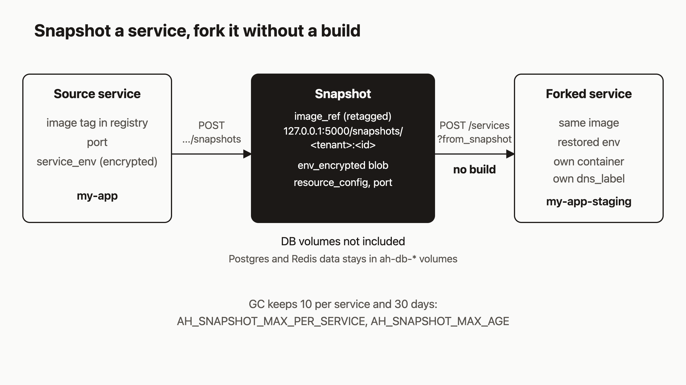

# Snapshot a working service and fork it into a copy

Before you change a working service, make a copy and break the copy first. I think this matters more with AI agents, because an agent will change a config value as readily as a human will, and it should not have to test that change on production.

This tutorial shows how to do that on agentic-hosting. You will take a named snapshot of a running service, then create a second service from the snapshot. The copy gets the same image, the same port and the same env vars, and it never goes through a build. Then you will change the copy's env and check that the original did not move.

These commands were checked against the source code, not executed for this post. Output shapes come from the handlers.

## Prerequisites

- A tenant API key and a service that has been deployed. If you do not have one yet, the earlier tutorials in this series cover registering and deploying.
- The API base. The hosted one is `https://api.agentic.hosting`. Self-hosters use their own host.

`ahc` reads `AH_URL` and `AH_KEY`, so set those and reuse them in curl:

```bash
export AH_URL=https://api.agentic.hosting
export AH_KEY=<your-key>
```

## 1. Deploy a service and set an env var

Create the source service with an env var in the same call:

```bash
curl -X POST $AH_URL/v1/services \
  -H "Authorization: Bearer $AH_KEY" \
  -H "Content-Type: application/json" \
  -d '{"name":"my-app","image":"nginxinc/nginx-unprivileged","port":8080,"env":{"GREETING":"hello"}}'
```

The response is a 201 with `"status":"deploying"`. Copy the `id` into `$SVC`. Wait until `GET /v1/services/$SVC` shows the service as running.

The snapshot needs a built image on the service. If the service has none, the API returns a conflict: "service has no built image to snapshot".

## 2. Take a snapshot

With curl:

```bash
curl -X POST $AH_URL/v1/services/$SVC/snapshots \
  -H "Authorization: Bearer $AH_KEY" \
  -H "Content-Type: application/json" \
  -d '{"name":"before-change"}'
```

With the CLI, which looks the service up by name:

```bash
ahc snapshot take my-app --name before-change
```

If you leave out `--name`, `ahc` uses `pre-change-YYYYMMDD` with today's date. Over the API, `name` is required and can be at most 128 characters. You can also send a `description` of up to 1024 characters.

The API returns 201 with the snapshot:

```json
{
  "id": "<32-hex-id>",
  "tenant_id": "...",
  "service_id": "...",
  "name": "before-change",
  "image_ref": "127.0.0.1:5000/snapshots/<tenant>:<id>",
  "resource_config": "{...}",
  "port": 8080,
  "created_at": 1700000000
}
```

Copy `id` into `$SNAP`.

## 3. List snapshots

```bash
ahc snapshot list
curl -H "Authorization: Bearer $AH_KEY" $AH_URL/v1/snapshots
```

The CLI prints a table with ID and SERVICE cut to 8 characters, plus NAME and CREATED. Add `--json` for the full records. The API accepts `service_id`, `name` (substring match) and `since` (a unix timestamp) as filters, plus `limit` and `offset`. Newest snapshots come first.

To look at one snapshot, call `GET /v1/snapshots/$SNAP`. The `env_vars` field lists your keys with every value masked as `********`. Add `?reveal=true` to decrypt the values. Each reveal writes an audit line to the server log with the tenant, the snapshot and the API key ID.

## 4. Fork the snapshot

```bash
curl -X POST "$AH_URL/v1/services?from_snapshot=$SNAP" \
  -H "Authorization: Bearer $AH_KEY" \
  -H "Content-Type: application/json" \
  -d '{"name":"my-app-staging"}'
```

The body takes only `name`, which is required. The response is a 201 with `"status":"deploying"`, and the deploy runs in the background like any other. Copy the new `id` into `$FORK`.

The new service uses the snapshot's `image_ref` as its image and the snapshot's port. The env vars are decrypted from the snapshot and written to the new service as its own. No Nixpacks build runs, because the image already exists in the local registry. `ahc` has no fork command, so this step is curl only.

Check the result:

```bash
curl -H "Authorization: Bearer $AH_KEY" $AH_URL/v1/services/$FORK
curl -H "Authorization: Bearer $AH_KEY" "$AH_URL/v1/services/$FORK/env?reveal=true"
```

You should see the snapshot's image reference, port 8080, and `GREETING` set to `hello`. The fork has its own ID, its own container and its own `dns_label`, so it gets its own URL.

## 5. Change the fork and check the original

Set a different value on the fork, then restart it so the container picks it up:

```bash
ahc service env set my-app-staging GREETING=howdy
ahc service restart my-app-staging
```

The env call replies `{"status":"updated","note":"restart will recreate the container with the new env vars"}`. Now read both services:

```bash
ahc service env get my-app --reveal
ahc service env get my-app-staging --reveal
```

`my-app` still says `hello`. `my-app-staging` says `howdy`. The fork's env lives in its own rows, and the snapshot is not touched either, so you can fork from it again for a fresh copy.

## How it works

The diagram shows the flow.



When you take a snapshot, the server does three things. It adds a new tag to the service's image, `127.0.0.1:5000/snapshots/<tenant>:<id>`, so the image stays available. It copies the service's env rows as they are, still encrypted, into one JSON blob. And it records the port and a `resource_config` read from your tenant's quotas. All of that goes into the `snapshots` table. If the database insert fails, the server tries to remove the new tag again.

When you fork, the server loads the snapshot for your tenant, decrypts the env with the master key, validates the image, env and port again, and creates a normal service from them. Only the snapshot's own tenant can read it.

The fork request restores the image, the port and the env. It does not read `resource_config` back into the new service, so I would not rely on the snapshot to carry resource limits across.

## What a snapshot is not

A snapshot is not a database dump and not a volume backup. Postgres and Redis data lives in `ah-db-*` volumes and is not part of it. If your app needs data to behave like production, the fork starts without any. The `snapshots` table has a `db_dump_path` column, but the snapshot code never writes to it.

There is also no restore call. The only thing you can do with a snapshot is fork a new service from it. For the SQLite state file, see `ah backup` in the [backups doc](https://agentic.hosting/docs/backups/), which is a separate thing.

Because the fork's image reference is the snapshot's tag, deleting the snapshot removes that tag. I did not check what that does to a later redeploy of a fork. If you plan to keep a fork around, treat the snapshot as something it depends on.

## Retention

Garbage collection removes snapshots by count and by age. Both limits are set when `ah` starts:

| Variable | Default | Meaning |
|---|---|---|
| `AH_SNAPSHOT_MAX_PER_SERVICE` | 10 | Newest snapshots kept per service. 0 means unlimited. |
| `AH_SNAPSHOT_MAX_AGE` | 30 days | Older snapshots are removed. 0 means unlimited. Use a Go duration such as `720h`. |

If a value cannot be parsed, the default is used. To remove one by hand, run `ahc snapshot delete <name-or-id> --confirm`, or call `DELETE /v1/snapshots/$SNAP`, which returns 204.

## Use it from Claude Code

The repo ships a `/ah-snapshot` command:

```
/ah-snapshot my-app before-change
```

It looks up the service by name, takes the snapshot with `POST /v1/services/{id}/snapshots`, shows the ID, name and creation time, and lists your existing snapshots. If you skip the second argument, the name defaults to `pre-change-` plus the date.

## What to try next

- Read how services deploy and what the async deploy path does: [Deploy](https://agentic.hosting/docs/deploy/).
- Manage env vars and secrets in detail: [Env](https://agentic.hosting/docs/env/).
- Add a database to the fork and give it its own data: [Databases](https://agentic.hosting/docs/databases/).
- Check the full endpoint list: [API](https://agentic.hosting/docs/api/).
- Source and issues: [github.com/dennisonbertram/agentic-hosting](https://github.com/dennisonbertram/agentic-hosting).
