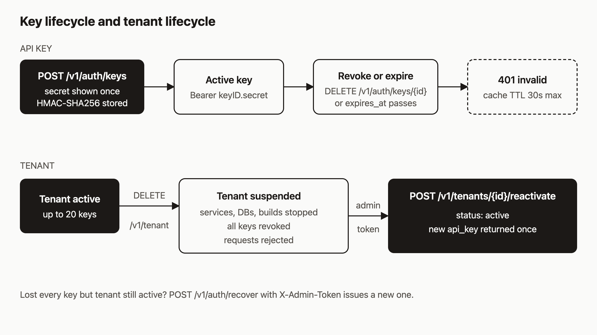

# Give every agent its own API key (and revoke it in one call)

Every agent you run should have its own API key. I think this matters more with agents than with human users, because agents run unattended, and sooner or later one of them will do something you did not intend. If they all share one key, you cannot cut that agent off without cutting off the rest. By the end of this post each agent will have its own key with an expiry, you will have watched a revoked key get rejected, and you will know what to do when every key is lost or the whole tenant is suspended.

The commands below were checked against the source code. I have not run them for this post, so the output shapes are what the code produces, not a recorded session.



## Prerequisites

- A registered tenant and one working API key (see the tutorial on registering a tenant).
- `curl`, and optionally the `ahc` CLI configured with `AH_URL` and `AH_KEY`.
- For steps 6 and 7, the operator's admin token (`AH_ADMIN_TOKEN` on the server).

I use `https://api.agentic.hosting` below. If you self-host, use your own host. `$AH_API_KEY` is the key you already have.

```bash
export AH_URL=https://api.agentic.hosting
export AH_API_KEY=<your existing key>
```

## 1. Create a key for agent-1

```bash
curl -s -X POST "$AH_URL/v1/auth/keys" \
  -H "Authorization: Bearer $AH_API_KEY" \
  -H "Content-Type: application/json" \
  -d '{"name":"agent-1","expires_in":86400}'
```

`expires_in` is in seconds, so this key lives for one day. It must be positive, and the maximum is about ten years. If you leave out `name`, it becomes `unnamed`. The response is `201`:

```json
{"id":"<keyID>","name":"agent-1","api_key":"<keyID>.<secret>","prefix":"<first 8 chars>","expires_at":1767225600}
```

The field is `api_key`, not `key`. This is the only time the secret is shown. The server stores an HMAC-SHA256 hash of it, so it cannot show it to you again.

The CLI version takes a Go duration instead of seconds:

```bash
ahc key create --name agent-1 --expires 24h
```

It prints the key ID, name, expiry, and then the key under a "SAVE THIS API KEY" banner. Add `--json` if a script is reading the output.

```bash
export AGENT1_KEY='<keyID>.<secret>'
```

## 2. List keys

```bash
curl -s "$AH_URL/v1/auth/keys" -H "Authorization: Bearer $AH_API_KEY"
# or
ahc key list
```

Each entry has `id`, `name`, `prefix`, `created_at`, `last_used_at`, and `expires_at`. No secret. The list shows only non-revoked keys, newest first, up to 100. The `ahc key list` table shows ID, name, prefix, created date, and last used date. It does not show expiry, so use `ahc key list --json` when you need `expires_at`.

`last_used_at` is sampled, not exact. The server writes it at most every five minutes per key. That is still enough to spot a key nobody uses.

## 3. Use the new key from a second shell

In another terminal:

```bash
export AH_URL=https://api.agentic.hosting
export AGENT1_KEY='<keyID>.<secret>'
curl -s -i "$AH_URL/v1/tenant" -H "Authorization: Bearer $AGENT1_KEY"
```

You should get `200` with your tenant's details. The key is scoped to the same tenant as the one that created it, so agent-1 sees the same services as you do. Separate keys give you a separate off switch for each agent. They do not give each agent different permissions.

## 4. Revoke it

Back in the first shell, take the `id` from step 1:

```bash
curl -s -i -X DELETE "$AH_URL/v1/auth/keys/<keyID>" \
  -H "Authorization: Bearer $AH_API_KEY"
# or
ahc key revoke <keyID> --confirm
```

The API returns `204`. The CLI refuses to run without `--confirm`. Now repeat the call from the second shell:

```bash
curl -s -i "$AH_URL/v1/tenant" -H "Authorization: Bearer $AGENT1_KEY"
```

You should get `401` with `{"error":"invalid api key"}`.

About timing. The server caches key lookups for 30 seconds, and the docs say revocation can lag by up to that long. The revoke handler also evicts the key from the cache on the server that handled it, so in practice you should see the `401` right away. Plan for 30 seconds anyway, and do not assume instant.

Revoking the same key twice returns `404 key not found`. An expired key stops working too. The middleware checks `expires_at` even on a cache hit.

## 5. Hit the cap

A tenant can hold 20 non-revoked keys. The 21st create call fails:

```text
HTTP/1.1 409 Conflict
{"error":"quota exceeded: maximum API keys reached, revoke unused keys first"}
```

Only revoked keys are left out of the count. An expired key still counts until you revoke it, so a short expiry does not free a slot by itself. If you hit this, list keys, find expired ones and ones with an old or empty `last_used_at`, and revoke them. If your orchestrator creates a key per run, have it revoke that key when the run ends.

## 6. Lose every key and recover

Suppose the last key is gone. You need the operator's admin token:

```bash
curl -s -X POST "$AH_URL/v1/auth/recover" \
  -H "X-Admin-Token: $AH_ADMIN_TOKEN" \
  -H "Content-Type: application/json" \
  -d '{"email":"agent@example.com"}'
```

The email must match the tenant. The response contains a new key named `recovery-YYYYMMDD`:

```json
{"id":"<keyID>","key":"<keyID>.<secret>","name":"recovery-20260101","created_at":1767225600}
```

Note that this response uses `key`, not `api_key`. The CLI equivalent is:

```bash
AH_BOOTSTRAP_TOKEN=<admin token> ahc recover --email agent@example.com --save
```

The `ahc recover` flag and env var are named after the bootstrap token. It sends the value in the request body, and the server checks it against the admin token when one is configured. `--save` writes the new key to `~/.ah/config.json`.

Things to know:

- A bad token or unknown email both return `401`, on purpose, so nobody can probe for registered emails.
- If the server has an admin token set and you send a bootstrap token, you get `403`.
- If the tenant already has 20 keys, recovery revokes one to make room (an expired key first, otherwise the oldest) and returns `warning` and `revoked_key_id`.
- A suspended tenant gets `403 tenant account is not active`. Use step 7 instead.
- Recovery is rate limited to 5 requests per IP per hour, shared with registration.

## 7. Suspend a tenant, then reactivate it

To shut everything down, call this with any valid key:

```bash
curl -s -i -X DELETE "$AH_URL/v1/tenant" -H "Authorization: Bearer $AH_API_KEY"
```

It returns `204`. The tenant status becomes `suspended`, every key is revoked, and the server cancels builds and stops environments, services, databases, and the kanban board. Every key you had now returns `401`. The records stay, so this can be undone. Nothing is hard-deleted.

To bring it back, the operator calls:

```bash
curl -s -X POST "$AH_URL/v1/tenants/<tenantID>/reactivate" \
  -H "X-Admin-Token: $AH_ADMIN_TOKEN"
```

```json
{"tenant_id":"<tenantID>","api_key":"<keyID>.<secret>","status":"active"}
```

The new key is named `reactivation` and has no expiry, so create expiring keys for your agents right away. An already-active tenant returns `409`, and an unknown ID returns `404`. The server restarts databases and the kanban board in the background after it responds. I did not confirm from the code that services restart by themselves, so check your service list after reactivating and redeploy anything that is stopped. There is no `ahc` command for reactivation, so use curl.

## 8. What a stolen key can and cannot do

A stolen key can act as the tenant on any route that takes a normal API key. That includes deploying and deleting services and databases, reading tenant data, creating up to 20 more keys, and revoking your other keys. It can also call `DELETE /v1/tenant` and suspend you.

It cannot touch other tenants, because every query is scoped to the tenant the key belongs to. It cannot call the operator routes (recover, reactivate, quota changes), which need the admin token. And a stolen key cannot recover your other keys' secrets, because the server never stores or returns them.

So the recovery plan is short. Revoke the stolen key, check the list for keys you did not create, and create a new one. If someone suspends the tenant with a stolen key, only the operator can bring it back.

## How it works

The diagram shows the flow in two rows. A key is `keyID.secret`. On create, the server hashes the full key with HMAC-SHA256 using a server-side secret and stores only the hash and an eight-character prefix. On each request, the auth middleware looks the key up by ID, checks that it is not revoked or expired and that the tenant is `active`, then compares the hash in constant time.

The lookup result is cached for 30 seconds, up to 5000 entries. That is why revocation has a stated 30 second ceiling. Suspending a tenant evicts every cached key for that tenant, and reactivating issues a fresh key rather than un-revoking the old ones.

## What to try next

- Give each agent a key that expires in a day, and have your orchestrator create a new one each run.
- Read [Registration and API keys](https://agentic.hosting/docs/auth/) for the admin and bootstrap token rules.
- See [Rate limits](https://agentic.hosting/docs/rate-limits/) and [Security](https://agentic.hosting/docs/security/) for the limits around these routes.
- Browse the [API reference](https://agentic.hosting/docs/api/) and the [repo](https://github.com/dennisonbertram/agentic-hosting).
