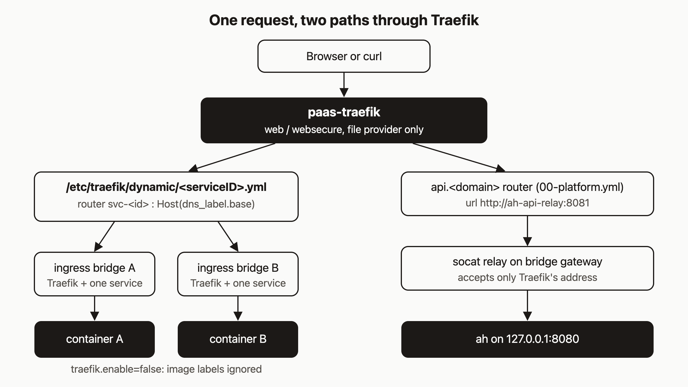

# How a request reaches your container: Traefik, file-provider routes and tenant networks

You deployed a service and the URL returns a 404 or a 502. Or you are about to run someone else's Docker image and want to know whether it can steal traffic by adding a few labels. Both questions have the same answer, and it starts with knowing how a request travels from the internet to the container.

I think this matters more when AI agents deploy your software. An agent will often pick the image, and you may never read its Dockerfile. So the safety of your routing cannot depend on what is inside the image.

By the end of this post you will be able to trace a public request to a tenant container, find the route file that makes it work, and explain why an image cannot register its own route.

The commands below were checked against the code. I did not run them for this post, so the output shapes are what the code says to expect, not captured output.

## Prerequisites

- A running agentic-hosting host that you can SSH into (self-hosted), or your own tenant on the public API at `https://api.agentic.hosting/v1/`. Self-hosted readers use their own API host.
- A deployed service. The deploy tutorial earlier in this series covers it.
- `AH_API_KEY` set in your shell. Never paste a real key into a ticket or a chat.

## Step 1: Walk one request

Take a service with `dns_label` `hello` on base domain `apps.example.com`. A request to `https://hello.apps.example.com` goes through these hops:

1. DNS resolves the name to the host. Tenant services live under the base domain you set with `--base-domain` or `AH_BASE_DOMAIN`.
2. `paas-traefik` accepts it on an entry point (`web` or `websecure`).
3. Traefik matches the `Host` header against a router defined in a YAML file in `/etc/traefik/dynamic`.
4. That router points at a service URL like `http://ah-route-service-<serviceID>:<port>`.
5. The name resolves only on a small Docker bridge that holds Traefik and that one service.
6. The request reaches the container port.

Nothing in that chain reads anything from the container itself.

## Step 2: Find the route file

Get the service ID and label:

```bash
curl -s -H "Authorization: Bearer $AH_API_KEY" \
  https://api.agentic.hosting/v1/services/$SERVICE_ID
# {"id":"...","name":"hello","dns_label":"hello","status":"running","port":8000,"url":"https://hello.apps.example.com", ...}
```

The CLI equivalent is `ahc service get hello`. On the host, the file is named after the service ID. The directory comes from `AH_TRAEFIK_CONFIG_DIR`, which defaults to `/etc/traefik/dynamic`:

```bash
ls /etc/traefik/dynamic
cat /etc/traefik/dynamic/$SERVICE_ID.yml
```

In the default production mode (Traefik terminates TLS) the file contains two routers, one redirect middleware and one service:

```yaml
http:
  routers:
    svc-<serviceID>-http:
      rule: "Host(`hello.apps.example.com`)"
      entryPoints: [web]
      middlewares: [svc-<serviceID>-redirect-https]
      service: svc-<serviceID>
    svc-<serviceID>:
      rule: "Host(`hello.apps.example.com`)"
      entryPoints: [websecure]
      service: svc-<serviceID>
      tls:
        certResolver: letsencrypt
  services:
    svc-<serviceID>:
      loadBalancer:
        servers:
          - url: "http://ah-route-service-<serviceID>:8000"
```

(The real file lays the same content out slightly differently, and also contains the middleware definition.) If the host sits behind an upstream proxy that terminates TLS, `ah` writes a single `web` router that sets `X-Forwarded-Proto: https`. With no base domain, the host is `<serviceID>.localhost` on `web` only.

`ah` writes this file to a temporary name and renames it, so Traefik never reads a half-written file. Traefik's file provider has `watch: true`, so it reloads on change.

## Step 3: Understand `traefik.enable=false`

Traefik can also discover routes from Docker labels. That is a bad idea here, because tenants choose the image and an image can ship any label it likes. A malicious image could claim `Host(`your-bank.example.com`)`.

Two things prevent this. First, `RunContainer` in `internal/docker/client.go` forces `traefik.enable=false` on every service container after merging labels, so a label in the image cannot turn it back on. Second, `traefikLabels` in `internal/services/services.go` returns an empty map, so `ah` does not pass routing labels either. Routes exist only as files that `ah` writes.

The Traefik config in `deploy/traefik/traefik.yml` in the repo still lists a Docker provider with `exposedByDefault: false`. The installer, `scripts/bootstrap-stack.sh`, writes a Traefik config with only the file provider. On a bootstrapped host there is no Docker provider to attack.

## Step 4: Inspect the networks

Each tenant has a bridge named `ah-tenant-<tenantID>`, created internal (no outbound route) with inter-container communication off. Each routed service also gets its own ingress bridge named `ah-ingress-<tenantID>-service-<serviceID>`. Only `paas-traefik` and that one service are attached to it:

```bash
docker network ls --filter name=ah-
docker network inspect ah-ingress-<tenantID>-service-<serviceID> \
  --format '{{range .Containers}}{{.Name}} {{end}}'
# paas-traefik ah-<tenantID>-<serviceID>
```

The service's name on that bridge is the alias `ah-route-service-<serviceID>`, which is what the route file's `url` uses. The alias is scoped to the ingress bridge, so the name is not ambiguous.

Tenant A and tenant B sit on different bridges, and each service's ingress bridge is its own. A container cannot reach another tenant's container by name or by private IP. One caveat from `docs/security/tenant-to-traefik-repro.md`: a workload can still reach Traefik on its own ingress bridge and send a `Host` header for another public route. That is the same as calling the public hostname, so protect your app with its own authentication.

## Step 5: Know why URLs stay stable

When a service is created and a base domain is set, `ah` derives a `dns_label` from the name and stores it in the `services` table. A unique index on `dns_label` makes labels globally unique, so a taken label returns a conflict error. Labels are at most 63 characters, and these names are reserved: `api`, `admin`, `dashboard`, `traefik`, `www`, `mail`, `smtp`, `health`, `status`, `metrics`, `grafana`, `prometheus`, `registry`, `auth`, `login`, `oauth`. Labels starting with `env-` are reserved for environment previews. Restarts and redeploys reuse the stored label. Renaming a service (`ahc service rename`) derives a new label, so the URL does change on rename.

## Step 6: The API path

The API takes a different route. A router for `api.<domain>` (from `00-platform.yml`, written by the installer) sends traffic to `http://ah-api-relay:8081`. That name points at the bridge gateway, where a `socat` relay (`ah-api-proxy.service`) listens. The relay accepts connections only from Traefik's fixed address and forwards them to `ah` on `127.0.0.1:8080`.

Because the relay connects to loopback, `ah` sees a loopback peer. In `internal/api/server.go`, `requireHTTPS` trusts `X-Forwarded-Proto: https` only when the peer address is loopback. For any other peer, `stripUntrustedForwardedHeaders` deletes `X-Forwarded-For`, `X-Forwarded-Proto` and `X-Real-Ip` first, and `requireHTTPS` requires real TLS. A client on the internet cannot claim HTTPS by sending a header.

## Step 7: Debug a 404 or 502

Work from the outside in.

```bash
# 1. Does the service exist and is it running?
ahc service get hello

# 2. Does the route file exist, and does the Host rule match the URL?
ls /etc/traefik/dynamic/$SERVICE_ID.yml
grep -E 'rule|url' /etc/traefik/dynamic/$SERVICE_ID.yml

# 3. Is the container up?
docker ps --format 'table {{.Names}}\t{{.Status}}'

# 4. Is Traefik on the ingress bridge with the container?
docker network inspect ah-ingress-<tenantID>-service-<serviceID> \
  --format '{{range .Containers}}{{.Name}} {{end}}'

# 5. Traefik's view
docker logs paas-traefik 2>&1 | tail -50
```

How to read the results:

- **404 and no route file.** Traefik has no router for that host. The file is missing if the service was deleted, failed to restart, or had its circuit breaker reset (`ah` removes the route in those cases), or if the route write failed. Stopping a service does not remove its file, so a stopped service usually returns a 502 rather than a 404. A failed write is only logged as a warning (`failed to write traefik route`), so check `journalctl -u ah`.
- **404 and the file exists.** The `Host` in the file does not match what you requested. Compare it with the `url` from the API.
- **502.** Traefik matched the router but cannot connect. Check that the container is running, that the port in the file's `url` matches the port the app listens on, and that both `paas-traefik` and the container appear on the ingress bridge. The `PORT` env var overrides the service port, and `ah` rewrites the route on restart to follow it.
- **API returns `{"error":"HTTPS required"}`.** The request reached `ah` without the loopback and header combination. See the troubleshooting page.

## How it works

The diagram shows the two paths. On the left, Traefik finds a per-service file, follows it to a dedicated bridge and reaches one container. Bridge A and bridge B are separate, and image labels are ignored. On the right, the API is routed to a relay that hands traffic to loopback.



The rule behind all of this is simple: routing data comes only from `ah`, written as files, and never from the workload.

## What to try next

- Read the [architecture](https://agentic.hosting/docs/) page and the [troubleshooting](https://agentic.hosting/docs/) page in the docs.
- Read the install guide before standing up your own host.
- Browse the code at https://github.com/dennisonbertram/agentic-hosting, starting with `writeTraefikRoute` in `internal/services/services.go`.
