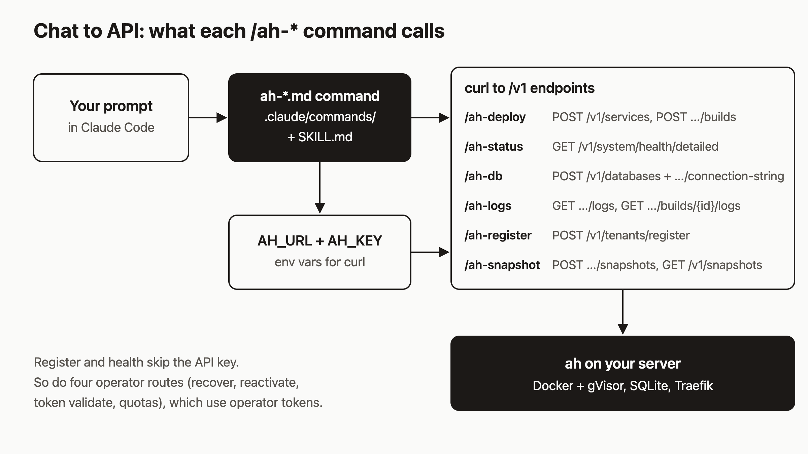

# Deploy from Claude Code with the agentic-hosting skill and /ah-* commands

I think deploying should happen where you already work, and for a lot of us that is a Claude Code chat. You already talk to it all day. Deploying an app, adding a database and reading logs are three more things you can ask it to do, as long as it knows the agentic-hosting API. This post sets that up. By the end you will have the skill and six slash commands installed, your credentials set, and a full deploy, database and logs flow running from a chat.



## Prerequisites

- Claude Code installed.
- A running agentic-hosting server. The public API base is `https://api.agentic.hosting/v1/`. If you self-host, use your own host.
- `curl` on your machine.

I checked everything below against the repo's code and command files. I did not run these commands for this post, so the sample output shows shapes, not captured output.

## Step 1: Install the skill and commands

```bash
curl -fsSL https://agentic.hosting/install-skill.sh | bash
```

The script writes `SKILL.md` and four reference files (`api-reference.md`, `operations.md`, `custom-domains.md`, `server-setup.md`) to `~/.claude/skills/agentic-hosting/` (`SKILL.md` at the top, the reference files in its `references/` folder). It writes the six command files to `~/.claude/commands/`.

To copy by hand from a checkout of the repo:

```bash
mkdir -p ~/.claude/skills/agentic-hosting
cp .claude/skills/agentic-hosting/SKILL.md ~/.claude/skills/agentic-hosting/
cp .claude/commands/ah-*.md ~/.claude/commands/
```

Now set your credentials in your shell profile, then restart Claude Code so it sees them:

```bash
export AH_URL=https://your-host
export AH_KEY=keyid.secret
```

The key has the form `keyid.secret`. Every command except `/ah-register` reads both variables. `/ah-register` needs only `AH_URL`.

## Step 2: See which commands exist

There are six:

| Command | What it does |
|---|---|
| `/ah-deploy <git-url-or-image> <name> [port]` | Deploy from git or a Docker image |
| `/ah-status` | Health, services, databases, in-progress builds |
| `/ah-db <service> <postgres\|redis> [db-name]` | Create a database and wire it to a service |
| `/ah-logs <service> [build-id]` | Runtime logs, or build logs with a build ID |
| `/ah-register <tenant-name> <email>` | Register a tenant and get an API key |
| `/ah-snapshot <service> [snapshot-name]` | Snapshot a service |

There is no `/deploy`. Type `/ah-` and let autocomplete show you the list.

## Step 3: Get an API key

If you already have a key, put it in `AH_KEY` and skip ahead.

If not, run:

```text
/ah-register my-agent agent@example.com
```

The command file tells Claude to read the bootstrap token from your server over SSH (`grep AH_BOOTSTRAP_TOKEN /etc/default/ah`), then call `POST /v1/tenants/register` with the `X-Bootstrap-Token` header and `{"name","email"}`. The response contains `tenant_id` and `api_key`. The key is shown once, so copy it into `AH_KEY` right away. A `422` means the name or email is taken. A `401` means the bootstrap token is wrong, and Claude will ask you for it.

## Step 4: Deploy from git

```text
/ah-deploy https://github.com/you/your-app web 3000
```

The port defaults to 3000 if you leave it out. The command file tells Claude to follow this flow:

1. `GET /v1/system/health` to confirm the server answers.
2. `GET /v1/system/health/detailed` and stop if disk use is over 90%. The server itself reports a degraded status above 90% on either disk path.
3. Decide whether the first argument is a git URL (starts with `https://`) or an image name.
4. For git: `POST /v1/services` with `{"name":"web","image":"pending","port":3000}`. The `image` field is required, so `pending` is a placeholder. The build replaces it.
5. `POST /v1/services/{id}/builds` with `{"source_type":"git","source_url":"<url>","source_ref":"main"}`.
6. Stream `GET /v1/services/{id}/builds/{build-id}/logs?follow=true`.
7. Poll the service every 5 seconds, up to 10 minutes, until `status` is `running`.

Claude then reports the service ID, build ID, final status and URL. For an image, such as `/ah-deploy nginxinc/nginx-unprivileged web 8080`, it skips the build and creates the service with the image directly.

Because the build ref is hard-coded to `main` in the command file, tell Claude in plain words if you want another branch or a commit SHA.

## Step 5: Add a database

```text
/ah-db web postgres
```

Claude looks up `web` with `GET /v1/services`, then creates a database named `web-db` (the default is `<service>-db`) with `POST /v1/databases` and an `Idempotency-Key` header. Creation can take up to 30 seconds. It then fetches `GET /v1/databases/{id}/connection-string`, whose response is `{"connection_string": "..."}`, and sets the service's env:

```text
postgres -> DATABASE_URL
redis    -> REDIS_URL
```

Last, it calls `POST /v1/services/{id}/restart` and polls until the service is `running`. Your app reads `DATABASE_URL` from its environment on the next start.

Limitation: the connection string uses `127.0.0.1` and the database port is bound to the host's loopback only, so the service cannot connect to the database yet ([issue #164](https://github.com/dennisonbertram/agentic-hosting/issues/164)). The command sets the variable, but I would not rely on this workflow until that is fixed.

## Step 6: Read logs and check status

```text
/ah-logs web
```

With no second argument, this streams runtime logs from `GET /v1/services/{id}/logs?follow=true&tail=100`. Pass a build ID and it streams that build's logs instead.

```text
/ah-status
```

This reads `GET /v1/system/health/detailed` (disk, Docker, gVisor), lists services with `status`, `crash_count` and `circuit_open`, lists databases, and checks recent builds. It flags anything not `running` and any open circuit.

## Step 7: Keep secrets out of the chat

The `/ah-db` command file says: never print the full connection string, show only host and port. The skill's description also triggers on phrases like "provision a database", so the same habits apply when you ask in plain English.

This is only an instruction to the model. Nothing technical enforces it. The connection string still passes through the shell commands Claude runs, so it can appear in the tool call that sets the env var. If that matters to you, look at the command Claude proposes before approving it, and use a database you can rotate. The server also writes an audit log line each time a connection string is read.

## Step 8: When a command asks for something the API cannot do

Command files are prompts, and prompts drift from the code. That is the main weakness of this setup, so check them now and then. Two examples from this repo:

- `/ah-db` says to poll for database status `running`. The database manager in the code sets `ready` when provisioning finishes. If Claude waits for `running`, tell it to accept `ready`.
- `/ah-deploy` warns against sending `memory_mb` or `cpu_count` on create, and against a `git_url` or `branch` field. Those fields are not on the create request. Git builds use `source_type`, `source_url` and `source_ref` on the builds endpoint.

When Claude proposes a call that returns `400` or `422`, ask it to check the endpoint list in `references/api-reference.md` (installed with the skill) and use only fields listed there. If the API has no endpoint for what you want, say so and stop. Do not let the agent invent one.

## How it works

The diagram reads left to right. Your prompt reaches a command file in `~/.claude/commands/`. That file is a short instruction to Claude with `$1`, `$2` and `$3` filled from your arguments. `SKILL.md` adds the broader API knowledge, such as error meanings and the circuit breaker. Claude turns both into `curl` calls using `$AH_URL` and `$AH_KEY`, and the `ah` server on your host does the work. Registration, the basic health check (`GET /v1/system/health`), and a few operator routes (key recovery, tenant reactivation, bootstrap token validation, quota updates) skip the API key. Bootstrap token validation takes the bootstrap token; the other three take the admin token (`X-Admin-Token`) on current installs.

## What to try next

- `/ah-snapshot web before-change`, then fork it with `POST /v1/services?from_snapshot=<id>`.
- Read the [Claude Code skill](https://agentic.hosting/docs/claude-code/) and [API](https://agentic.hosting/docs/api/) docs, and the [troubleshooting guide](https://agentic.hosting/docs/troubleshooting/).
- Browse the command files and source at [github.com/dennisonbertram/agentic-hosting](https://github.com/dennisonbertram/agentic-hosting).
