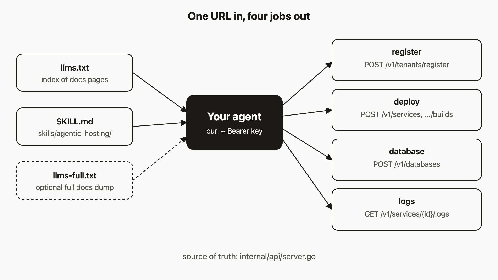

# Give any agent one URL and let it install and operate agentic-hosting

I think the fastest way to get an agent running your infrastructure is to give it one document to read. You don't need a tool wrapper, an MCP server, or a framework plugin first. A good skill file and `curl` are enough.

This post shows an agent that fetches one file, reads the API map inside it, then registers a tenant, deploys a service, creates a database and reads logs. It also covers the facts agents tend to get wrong and the guardrails I would put around one.

*Note: the commands below were checked against the code, not executed for this post.*



## Prerequisites

- An agent that can fetch a URL and run shell commands. The model and framework don't matter.
- A running agentic-hosting server, or a server you want the agent to install. The public API base is `https://api.agentic.hosting/v1/`. If you self-host, use your own host.
- A bootstrap token (`AH_BOOTSTRAP_TOKEN`, stored in `/etc/default/ah` on the server) if the agent will register a tenant.

## 1. The three files you can share

The repo ships three agent-readable files. Each is available from raw GitHub:

| File | What it is |
|---|---|
| `llms.txt` | A short index in the [llmstxt.org](https://llmstxt.org/) format. Summary, key facts, links to every docs page. |
| `llms-full.txt` | Every docs-site page plus the API reference in one markdown file. Big, so use it only when the agent needs detail. |
| `skills/agentic-hosting/SKILL.md` | A single Agent Skills file with install, register, deploy, database, logs and the route table. |

```
https://raw.githubusercontent.com/dennisonbertram/agentic-hosting/main/llms.txt
https://raw.githubusercontent.com/dennisonbertram/agentic-hosting/main/llms-full.txt
https://raw.githubusercontent.com/dennisonbertram/agentic-hosting/main/skills/agentic-hosting/SKILL.md
```

`llms.txt` is also served at `https://agentic.hosting/llms.txt` and `https://agentic.hosting/docs/llms.txt`. If you use Claude Code, you can install the skill instead of pasting a URL:

```bash
mkdir -p ~/.claude/skills/agentic-hosting
curl -fsSL https://raw.githubusercontent.com/dennisonbertram/agentic-hosting/main/skills/agentic-hosting/SKILL.md \
  -o ~/.claude/skills/agentic-hosting/SKILL.md
```

## 2. Paste the URL and state a goal

Open an agent chat and send something like:

```
Read https://raw.githubusercontent.com/dennisonbertram/agentic-hosting/main/skills/agentic-hosting/SKILL.md
and follow it. The API is at https://api.agentic.hosting. Deploy
https://github.com/org/repo (port 3000) with a Postgres database, then
show me the last 100 log lines. My bootstrap token is in $AH_BOOTSTRAP_TOKEN.
```

Keep the goal concrete and give the agent the host. Don't paste the token into the chat if you can put it in the agent's environment instead.

## 3. What the agent should do

Here is the path the skill describes. Check each fact. These are the places where an agent trained on older docs or other PaaS products goes wrong.

**Register.** Validate the token with a JSON body, then register. Validate always returns HTTP 200.

```bash
curl -s -X POST "$AH_URL/v1/system/bootstrap-token/validate" \
  -H "Content-Type: application/json" -d "{\"token\":\"$AH_BOOTSTRAP_TOKEN\"}"
# {"valid":true}

curl -s -X POST "$AH_URL/v1/tenants/register" \
  -H "X-Bootstrap-Token: $AH_BOOTSTRAP_TOKEN" -H "Content-Type: application/json" \
  -d '{"name":"my-agent","email":"agent@example.com"}'
# {"tenant_id":"...","api_key":"keyid.secret"}   <- shown once
```

The agent must save `api_key` immediately. Registration is limited to 5 per IP per hour.

**Create the service with `image: "pending"`.** The create call requires `image`. For a git deploy, send the placeholder `"pending"`, then start a build, which replaces it. Send an `Idempotency-Key` so a retry doesn't create a second service.

```bash
curl -s -X POST "$AH_URL/v1/services" \
  -H "Authorization: Bearer $AH_KEY" -H "Content-Type: application/json" \
  -H "Idempotency-Key: $(uuidgen)" \
  -d '{"name":"web","image":"pending","port":3000}'
```

**Use `source_type`, `source_url` and `source_ref`.** There is no `git_url` or `branch` field on builds. `source_ref` defaults to `main`.

```bash
curl -s -X POST "$AH_URL/v1/services/$SERVICE_ID/builds" \
  -H "Authorization: Bearer $AH_KEY" -H "Content-Type: application/json" \
  -d '{"source_type":"git","source_url":"https://github.com/org/repo","source_ref":"main"}'
```

The git URL must be HTTPS, without credentials, on github.com, gitlab.com, bitbucket.org, sr.ht or codeberg.org.

**Poll status, and read `circuit_open` separately.** The skill tells the agent to poll `GET /v1/services/{id}` for up to 10 minutes. `status` is never the string `"circuit_open"`. That is a separate boolean field, so the agent must stop on `status == "running"`, `status == "failed"`, or `circuit_open == true`. If the circuit opens, the fix is to repair the app, call `POST .../reset`, then `POST .../redeploy`. Don't call `/start` after a reset: reset removes the container, so start returns 409.

**Create the database and wire it in.** Database creation can take around 30 seconds, so use an idempotency key again.

```bash
curl -s -X POST "$AH_URL/v1/databases" \
  -H "Authorization: Bearer $AH_KEY" -H "Content-Type: application/json" \
  -H "Idempotency-Key: $(uuidgen)" -d '{"name":"mydb","type":"postgres"}'
curl -s -H "Authorization: Bearer $AH_KEY" "$AH_URL/v1/databases/$DB_ID/connection-string"
# {"connection_string":"..."}
```

Then `POST /v1/services/$SERVICE_ID/env` with `DATABASE_URL`, and `POST .../restart`. The env endpoint merges, so it won't wipe existing variables. The skill also tells the agent not to print the full connection string back to you.

**Read logs.**

```bash
curl -sN -H "Authorization: Bearer $AH_KEY" \
  "$AH_URL/v1/services/$SERVICE_ID/logs?follow=true&tail=100"
```

The skill says the server write timeout is 30 seconds. In the code, the HTTP server sets no global write timeout. Log streams get a 60-second idle write deadline, so a stream that stops being read gets cut off. If a follow stream dies, either way, the agent should reconnect in short bursts. Build logs are at `/v1/services/{id}/builds/{buildID}/logs`.

Idempotency keys are easy to misuse. A key applies to POST and PUT only, the stored response lives for 10 minutes, and it isn't applied to `POST /v1/auth/keys` or `POST /v1/environments/{id}/exec`.

## 4. A transcript

I don't have a recorded, redacted transcript from a real run to show you, and I won't write a fake one. When you run this yourself, scan your agent's transcript for four mistakes, each of which has a specific error message:

- A build body with `git_url` or `branch` fails with `unsupported source_type`.
- A create call without `image` fails with `image is required`.
- A poll loop that waits for `status == "circuit_open"` never ends. It should read the boolean.
- An agent that calls `/start` after a reset gets a 409.

If you capture a good run, redact the `api_key`, bootstrap token and connection strings before you publish it.

## 5. When the skill and the docs disagree

The skill says it directly: canonical routes live in `internal/api/server.go`, and if the skill and a blog post disagree, trust the live API. Older docs said things like `git_url`, a 24-hour idempotency TTL, or `/v1/tenant/reactivate`. The repo keeps `docs-site/CORRECTIONS.md` to list those stale claims next to the correct form.

Tell your agent what to do when a call returns something unexpected: re-read the route table in the skill, check `server.go` if it has the repo, and don't invent fields. This post is one of those blog posts, so apply the same rule to it.

## 6. Guardrails to add

The agent runs with a real key against a real server. Set a few limits before you hand it over:

- **One tenant per agent.** API keys are tenant-wide. The code has no per-key permission scopes, so the isolation boundary is the tenant. Register a separate tenant for each agent.
- **Short-lived keys.** `POST /v1/auth/keys` accepts `name` and `expires_in` in seconds (maximum 10 years), and a tenant can hold up to 20 keys. Give the agent a key that expires in hours, and revoke it with `DELETE /v1/auth/keys/{keyID}`.
- **Quotas.** An operator can lower `max_services`, `max_databases`, `max_builds_concurrent` and `max_env_vars_per_service` with `PATCH /v1/tenants/{tenantID}/quotas`. This needs the admin token, which the agent should not have.
- **Keep the bootstrap and admin tokens away from the agent** once it has its own tenant key.

## How it works

In the diagram, the agent is the hub. `llms.txt` points it to docs pages and the skill, and the skill holds the working flow. From there it calls four groups of endpoints: register, deploy, database and logs. All of them are routed in `internal/api/server.go`, which is why the skill points there.

## What to try next

- Read the human version of this page: [Give this to your agent](https://agentic.hosting/docs/for-agents/).
- See the full route list in the [REST API reference](https://agentic.hosting/docs/api/).
- Walk through the same flow by hand in [Deploy](https://agentic.hosting/docs/deploy/) and [Databases](https://agentic.hosting/docs/databases/).
- Review [Registration and API keys](https://agentic.hosting/docs/auth/) and [Rate limits](https://agentic.hosting/docs/rate-limits/) before you set up guardrails.
- Read the source on [GitHub](https://github.com/dennisonbertram/agentic-hosting).
