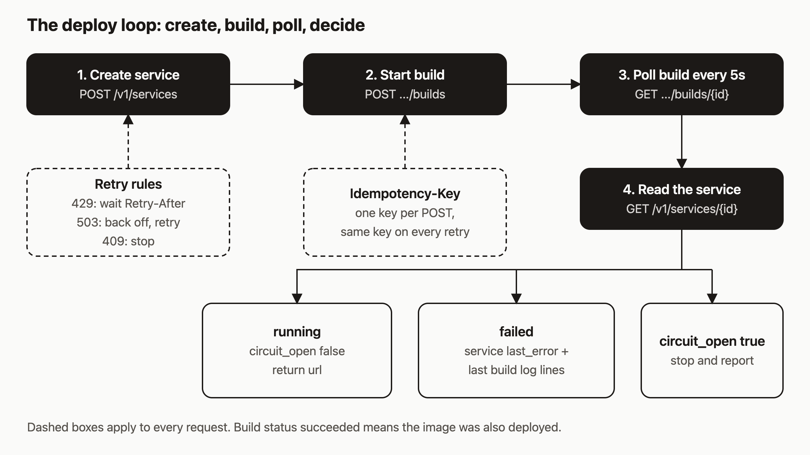

# Write an 80-line deploy loop that an agent can trust

Calling the deploy endpoint is the easy part of an agent tool or a CI step. The hard part is what happens when the network drops mid-request, the rate limiter says wait, the build fails, or the app crash-loops. I think an agent is only as good as the failure messages it gets back, because it can't fix what it can't read. A script that handles none of these cases works in the demo and fails the first time it matters.

By the end of this post you will have one Python file with no dependencies. It creates a service, builds it from a git repo, polls until the build reaches a final state, checks `circuit_open`, and prints one JSON result. On failure, that result includes the service's `last_error` and the last 20 lines of the build log, so the agent has something to act on.



## Prerequisites

- Python 3 and an API key. If you do not have a key, the [install guide](https://agentic.hosting/docs/install/) and [auth guide](https://agentic.hosting/docs/auth/) cover registration.
- A public git repo on an allowed host (the skill file lists github.com, gitlab.com, bitbucket.org, sr.ht and codeberg.org, HTTPS only, no credentials in the URL). Nixpacks has to be able to build it.

```bash
export AH_URL="https://api.agentic.hosting"   # or your own host
export AH_API_KEY="<keyID>.<secret>"          # never commit this
```

The public API base is `https://api.agentic.hosting/v1/`. Self-hosted readers use their own address.

A note on how I checked this: I read the handlers and middleware and wrote the script against them. I ran the control flow against a small local mock server to catch typos. I did not run it against a real agentic-hosting server, so the output below shows the shape of a result, not captured output.

## Step 1: Know the contract

Every request sends `Authorization: Bearer $AH_API_KEY`. Errors come back as JSON in one shape, `{"error":"..."}`, written by `internal/apierr/errors.go`. That means one error parser covers the whole API.

Four kinds of response decide what the script does:

| Status | Meaning here | Script does |
|---|---|---|
| 429 | Rate limit. `Retry-After` is in seconds, between 1 and 60 | Sleep that long, retry |
| 503 | Service or build system unavailable | Back off, retry |
| 409 | Quota exceeded, idempotency key reused with a different body, or build queue full | Stop and report |
| other 4xx or 5xx | Bad request, not found, internal error | Stop and report |

Retrying a 409 will not help. Retrying a 429 or 503 usually will.

## Step 2: Create the service with an idempotency key

`POST /v1/services` requires `name` and `image`. `port` is optional and defaults to 8000 when omitted; the script sends it explicitly. For a git build, `image` is still required. The skill file says to send the placeholder `"pending"`: create always starts an async deploy, the placeholder pull fails, and the build replaces the image. That has a consequence for the loop. Right after create, the service can show `status: "failed"` with an `image pull failed` error. That failure is expected, so the loop must not treat it as the final result.

The `Idempotency-Key` header makes retries safe. The middleware scopes a key by tenant, method, path and query string. If the first request succeeded (any 2xx), a repeat with the same key and body returns the stored response with an `Idempotency-Replayed: true` header instead of creating a second service. Entries last 10 minutes, keys can be at most 128 characters, and error responses are never stored. Reusing a key with a different body returns 409.

The script makes one random run id and derives `create-<run>` and `build-<run>` from it. Each POST keeps its key across all of its retries.

## Step 3: Start the build

`POST /v1/services/{id}/builds` takes `source_type` (only `git` is accepted), `source_url`, and an optional `source_ref` that defaults to `main`. It returns 202 with three fields: `build_id`, `status` and `image`. Note the name `build_id`. Some older docs say `id`, but the handler returns `build_id`.

## Step 4: Poll the build, then read the service

The script polls `GET /v1/services/{id}/builds/{buildID}` every 5 seconds for up to 10 minutes. It polls the build, not the service, because of the placeholder failure above. In `internal/builds/builds.go`, the build is marked `succeeded` only after the built image has been deployed. If that deploy fails, the build is marked `failed` and its log says so. So the build status is the signal to trust. The statuses are `pending`, `running`, `succeeded`, `failed` and `cancelled`. The loop treats `cancelled` as final too.

Once the build is final, one `GET /v1/services/{id}` gives `status`, `circuit_open`, `url` and `last_error`. The result counts as a success only if the build succeeded, the service is `running`, and `circuit_open` is false.

## Step 5: Return a result the agent can act on

On failure, the script adds `last_error` and the last 20 lines of `GET .../builds/{buildID}/logs`. Without `?follow=true` that endpoint returns plain text, so the script reads it as text rather than JSON.

## The script

Save this as `deploy_loop.py`.

```python
#!/usr/bin/env python3
"""Deploy a git repo to agentic-hosting and return a clear result. Stdlib only."""
import argparse, json, os, sys, time, urllib.error, urllib.request, uuid

BASE = os.environ.get("AH_URL", "https://api.agentic.hosting") + "/v1"
KEY = os.environ["AH_API_KEY"]

class Stop(Exception):
    pass

def call(method, path, body=None, idem=None, text=False):
    headers = {"Authorization": f"Bearer {KEY}", "Content-Type": "application/json"}
    if idem:
        headers["Idempotency-Key"] = idem
    data = json.dumps(body).encode() if body is not None else None
    for attempt in range(6):
        req = urllib.request.Request(BASE + path, data, headers, method=method)
        try:
            with urllib.request.urlopen(req, timeout=60) as r:
                out = r.read().decode()
                return out if text else (json.loads(out) if out else None)
        except urllib.error.HTTPError as e:
            raw = e.read().decode()
            try:
                msg = json.loads(raw)["error"]
            except Exception:
                msg = raw
            if e.code == 429:
                time.sleep(int(e.headers.get("Retry-After", "5")))
            elif e.code == 503:
                time.sleep(2 ** attempt)
            else:  # 409 and every other 4xx/5xx: stop, do not retry
                raise Stop(f"{method} {path} -> {e.code}: {msg}")
        except (urllib.error.URLError, TimeoutError):
            time.sleep(2 ** attempt)  # same Idempotency-Key, so a POST retry is safe
    raise Stop(f"{method} {path}: gave up after 6 attempts")

def deploy(name, repo, ref, port, service_id=None, timeout=600, state=None):
    state = state if state is not None else {}
    run = uuid.uuid4().hex  # reuse this value to retry the whole run safely
    if not service_id:
        svc = call("POST", "/services", {"name": name, "image": "pending", "port": port}, f"create-{run}")
        service_id = svc["id"]
    state["service_id"] = service_id
    b = call("POST", f"/services/{service_id}/builds",
             {"source_type": "git", "source_url": repo, "source_ref": ref}, f"build-{run}")
    bid, deadline = b["build_id"], time.time() + timeout
    while time.time() < deadline:
        build = call("GET", f"/services/{service_id}/builds/{bid}")
        if build["status"] in ("succeeded", "failed", "cancelled"):
            break
        time.sleep(5)
    else:
        return {"ok": False, "reason": "timeout", "service_id": service_id, "build_id": bid}
    svc = call("GET", f"/services/{service_id}")
    result = {"ok": False, "service_id": service_id, "build_id": bid, "image": b["image"],
              "build_status": build["status"], "status": svc["status"],
              "circuit_open": svc["circuit_open"], "url": svc.get("url")}
    if build["status"] == "succeeded" and svc["status"] == "running" and not svc["circuit_open"]:
        result["ok"] = True
        return result
    result["last_error"] = svc.get("last_error", "")
    log = call("GET", f"/services/{service_id}/builds/{bid}/logs", text=True)
    result["build_log_tail"] = log.splitlines()[-20:]
    return result

if __name__ == "__main__":
    p = argparse.ArgumentParser()
    p.add_argument("repo"); p.add_argument("--name", default="deploy-loop-demo")
    p.add_argument("--ref", default="main"); p.add_argument("--port", type=int, default=3000)
    p.add_argument("--service", help="rebuild an existing service id instead of creating one")
    p.add_argument("--cleanup", action="store_true", help="delete the service if the deploy fails")
    a = p.parse_args()
    state = {}  # deploy() records the service id here as soon as it exists
    try:
        res = deploy(a.name, a.repo, a.ref, a.port, a.service, state=state)
    except Exception as e:  # Stop, or a bad response shape after the service exists
        res = {"ok": False, "reason": str(e)}
    sid = state.get("service_id")
    if not res["ok"] and a.cleanup and sid and not a.service:
        try:
            call("DELETE", f"/services/{sid}")
            res["deleted"] = True
        except Stop as e:
            res["cleanup_error"] = str(e)
    print(json.dumps(res, indent=2))
    sys.exit(0 if res["ok"] else 1)
```

The `--service` flag is the redeploy path. Pass an existing service id and the script skips create and starts a new build on it. The `--cleanup` flag deletes a service the script created if the deploy fails, including when the failure is an error raised after the create call. It never deletes a service you passed with `--service`. The delete returns 204 with no body.

## Step 6: Run it

```bash
python3 deploy_loop.py https://github.com/YOUR_ORG/YOUR_REPO --name loop-demo --port 3000 --cleanup
```

A successful run prints this shape (values are placeholders):

```json
{
  "ok": true,
  "service_id": "<service id>",
  "build_id": "<build id>",
  "image": "127.0.0.1:5000/ah/<tenant>-<service>:<build>",
  "build_status": "succeeded",
  "status": "running",
  "circuit_open": false,
  "url": "<service url>"
}
```

A failed run has `"ok": false`, the same fields, plus `last_error` and `build_log_tail`. The exit code is 0 on success and 1 otherwise, so a CI step can gate on it.

## How it works

Follow the diagram left to right. The two dark boxes at the top are the writes, and both carry an idempotency key. The dashed boxes apply to every call: `call()` is the only function that touches the network, so retry logic lives in one place.

The 429 branch trusts the server's `Retry-After` value. The server computes it from the token bucket and caps it at 60 seconds. The 503 branch uses exponential backoff because no header tells you how long to wait. Network errors and timeouts back off the same way, and they are safe to retry for POSTs because of the key.

The bottom row is the decision. It reads `circuit_open` separately from `status` on purpose, and the reason is easy to miss. According to the guards doc, when the circuit breaker trips, `status` stays `crashed` and `circuit_open` is its own boolean. The service status is never the string `circuit_open`.

## What to try next

- Soak after success. The script reads the service once, right after the build succeeds. A crash-looping app takes longer to trip the breaker, so poll `GET /v1/services/{id}` for a minute before you call it healthy. The [guards page](https://agentic.hosting/docs/guards/) has the thresholds.
- When `circuit_open` is true, the guards doc says to use `POST .../redeploy`, not `/start`.
- Read the [API reference](https://agentic.hosting/docs/api/), [rate limits](https://agentic.hosting/docs/rate-limits/) and [troubleshooting](https://agentic.hosting/docs/troubleshooting/) pages.
- The [for-agents page](https://agentic.hosting/docs/for-agents/) covers the same API from an agent's point of view.
- Source and issues: [github.com/dennisonbertram/agentic-hosting](https://github.com/dennisonbertram/agentic-hosting).
