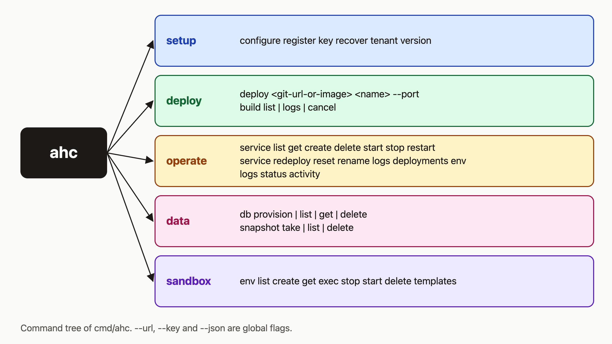

# A tour of the ahc CLI: configure, deploy, inspect, clean up

I think a CLI should be the shortest path from "I have code" to "it is running", and `ahc deploy` is shorter than assembling a `curl` request. This post walks through it. By the end you will have `ahc` installed and configured, you will have used each everyday command once on a real service, and you will know what the CLI cannot do yet.



## Prerequisites

- An agentic-hosting server and its URL. The public API is `https://api.agentic.hosting/v1/`. If you self-host, use your own host.
- Either an API key, or a bootstrap token from the operator so you can register a tenant.
- macOS or Linux, on amd64 or arm64. The install script rejects other systems.

I checked every command below against the source. I did not run them for this post, so the output samples are shapes, not captured logs.

## 1. Install and configure

```bash
curl -fsSL https://agentic.hosting/install-cli.sh | bash
ahc version
```

The script downloads the latest GitHub release, verifies it against `checksums.txt`, and installs to `/usr/local/bin` if it is writable, otherwise `~/.local/bin`. If that directory is not on your `PATH`, the script prints the line to add.

`ahc version` prints `ahc version <v> (commit <c>, built <date>)`. A locally built binary without release flags prints `dev` and `unknown`.

Now save your connection settings:

```bash
ahc configure --url https://api.agentic.hosting --key "$AH_API_KEY"
```

This writes `~/.ah/config.json`. Run `ahc configure` with no flags to see the saved URL and the first eight characters of the key.

## 2. Register, and override the config

If you have no key yet, register a tenant. You need a bootstrap token, passed as a flag or in `AH_BOOTSTRAP_TOKEN`:

```bash
ahc register "My Project" you@example.com --bootstrap-token "$AH_BOOTSTRAP_TOKEN" --save
```

The key is shown once. `--save` writes it, with the URL the client used, to `~/.ah/config.json`.

Every command takes `--url` and `--key`, and reads `AH_URL` and `AH_KEY`. The order is: flag, then environment variable, then config file. This means CI needs no config file at all:

```bash
export AH_URL=https://api.agentic.hosting
export AH_KEY="$AH_API_KEY"
ahc service list
```

## 3. Deploy

```bash
ahc deploy nginxinc/nginx-unprivileged my-site --port 8080
ahc deploy https://github.com/org/repo my-app --port 3000
```

A source starting with `http://` or `https://` is treated as a git repo. It is built with Nixpacks, and the build log streams with a `[build]` prefix. Anything else is a Docker image. Either way, `ahc` polls every 2 seconds, up to 150 times (5 minutes), and prints `URL: ...` when the service is running. If the service fails or crashes, the command exits with an error and points you to `ahc build logs`.

`ahc deploy --redeploy my-app` redeploys an existing service by name.

## 4. Inspect

```bash
ahc service list              # NAME STATUS ID URL RESTARTS
ahc service get my-app        # image, port, circuit state, last error
ahc logs my-app --tail 50 --follow
ahc build list my-app
ahc build logs my-app         # latest build if you omit the id
ahc build cancel my-app <build-id>
ahc activity --type service --limit 20
ahc status
```

Services take a name or a 32-character hex ID. `ahc logs` and `ahc service logs` are the same thing; both default to `--tail 100`. `ahc build list --all` lists builds for the whole tenant. `ahc activity` also takes `--since` in RFC3339 format.

`ahc status` prints system health, services and databases.

## 5. Operate

```bash
ahc service restart my-app
ahc service redeploy my-app
ahc service reset my-app          # reset the circuit breaker after a crash loop
ahc service rename my-app my-web
ahc service deployments my-web
```

`redeploy` recreates the container with the stored image and env. It does not build. `reset` clears the circuit breaker so a crash-looping service may restart.

Environment variables:

```bash
ahc service env set my-web LOG_LEVEL=debug FEATURE_X=on
ahc service env get my-web            # values shown as ***
ahc service env get my-web --reveal   # plaintext, audit-logged
ahc service env delete my-web FEATURE_X
ahc service redeploy my-web           # changes apply on the next restart or redeploy
```

The names are easy to confuse. `ahc service env` manages a service's variables. `ahc env` manages sandbox environments (`create`, `exec`, `stop`, `start`, `delete`, `templates`). They are unrelated.

## 6. Data

```bash
ahc db provision my-web postgres
ahc db list
ahc db get my-web-postgres
ahc snapshot take my-web --name before-migration
ahc snapshot list
```

`db provision` takes `postgres` or `redis`. It creates the database, waits for it to become ready, sets `DATABASE_URL` (or `REDIS_URL`) on the service, and restarts the service. The database is named `<service>-<type>` unless you pass `--name`. `db get` masks the password.

A snapshot records a service's current image and env vars. Without `--name` it is called `pre-change-YYYYMMDD`.

## 7. Scripts: `--json` and exit codes

`--json` is a global flag. These commands honor it: `service list/get/create/redeploy/rename/deployments`, `service env get`, `build list`, `db list/get/provision`, `snapshot list`, `activity`, `status`, `register`, `version`. With `db provision --json`, progress goes to stderr and stdout holds only the JSON.

```bash
ahc service get my-web --json | jq -r .status
```

Not every command does: `deploy`, `logs`, `snapshot take`, and the `start`, `stop`, `restart` and `reset` commands print text only.

Errors exit 1, except `ahc env exec`, which exits with the remote command's exit code (124 on timeout). `ahc status` also exits 1 when health is not ok, Docker or gVisor is unavailable, a disk is over 90% full, or a service or database is unhealthy. I like this because one command can be your whole health check in cron:

```bash
ahc status > /dev/null || echo "agentic-hosting needs attention"
```

## 8. Clean up

Destructive commands refuse to run without `--confirm`:

```bash
ahc service delete my-web --confirm
ahc db delete my-web-postgres --confirm
ahc snapshot delete <snapshot-id> --confirm
ahc env delete my-sandbox --confirm
ahc key revoke <key-id> --confirm
```

Deleting a service also deletes its env vars and deployment history. Deleting a database removes its data. Neither can be undone.

## How it works

The diagram groups the commands by purpose. Most commands load the URL and key (flag, then environment, then config file), resolve a service name to its ID by listing your services, then call the HTTP API. `configure` and `version` skip all of that, and the `db`, `env` and `snapshot` commands resolve their own IDs. If two services share a name, `ahc` stops with an "ambiguous" error and asks for the ID.

## What the CLI cannot do yet

- No snapshot restore command. `ahc snapshot` has `take`, `list` and `delete`.
- No way to set env vars from a file. `service env set` takes `KEY=VALUE` arguments.
- No `--json` on `deploy`, `logs`, `snapshot take` and the lifecycle commands.
- `db list` shows `-` in its SERVICE column, because the CLI does not receive that field.
- The 5-minute limit applies to the polling that follows the build, not the whole command. `ahc` first streams the build log with no timeout, so a long build can keep the command running past 5 minutes.

## What to try next

- [Deploy guide](https://agentic.hosting/docs/deploy/) and [environment variables](https://agentic.hosting/docs/env/)
- [Databases](https://agentic.hosting/docs/databases/) and [backups](https://agentic.hosting/docs/backups/)
- [Troubleshooting](https://agentic.hosting/docs/troubleshooting/)
- Source and issues: https://github.com/dennisonbertram/agentic-hosting
