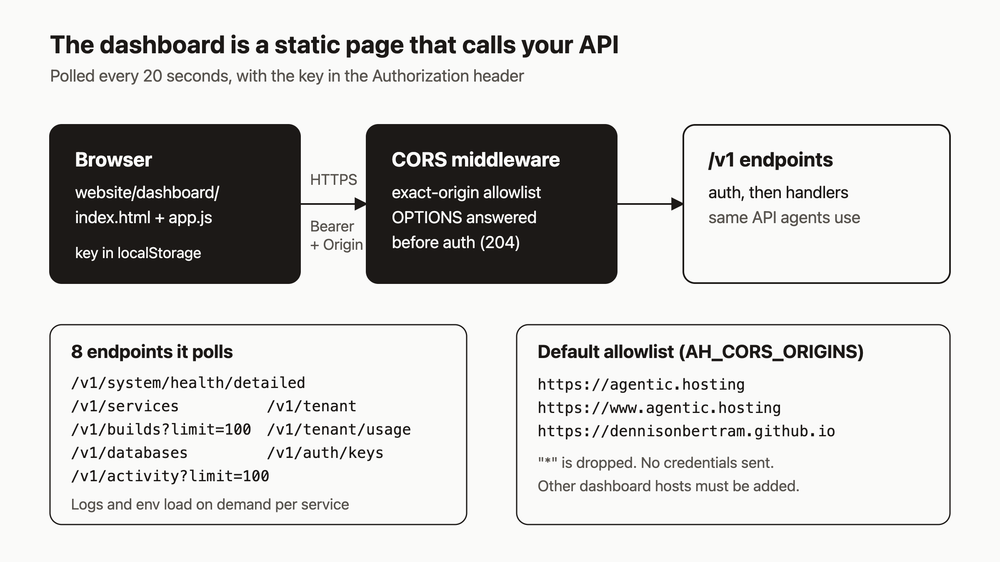

# Watch your agents work in the supervisory dashboard

Your agents are deploying services, and you may have no idea what they just did. You could ask them, but I think a person supervising agents should be able to open a page and look. By the end of this post you will have the `ah` dashboard connected to your API, showing services, builds, databases, activity and usage, and you will know how to fix the CORS error you are likely to hit on the first try.



## The idea

The API is the product. Agents use it directly, and `ahc` is a thin CLI over it. The dashboard is optional and is there for the human who supervises. It is a folder of static files (`website/dashboard/`) with no backend of its own. It calls the same `/v1` endpoints your agents call, using a tenant API key.

That means the dashboard can only show what your key can see, and every button in it is an ordinary API call.

## Prerequisites

- A running `ah` server with an HTTPS API host, for example `https://api.example.com`. The public one is `https://api.agentic.hosting`.
- A tenant API key. Export it as `$AH_API_KEY` in any shell where you want to test with curl.
- Optional: some services already deployed, so there is something to look at.

## Step 1: Open the dashboard with your API address

The hosted copy lives at `https://agentic.hosting/dashboard/`. Point it at your server with the `api` query parameter:

```
https://agentic.hosting/dashboard/?api=https://api.example.com
```

The page picks its API base in this order: the `?api=` value, then `https://api.agentic.hosting` if the page is served from `agentic.hosting`, `www.agentic.hosting` or a `*.github.io` host, then the page's own origin. That last case is what you get if you serve `website/dashboard/` yourself from any static file server. You can also edit the API base field in the page.

## Step 2: Paste your key

Paste the tenant key into the key field and connect. The page sends it on every request as `Authorization: Bearer <key>`.

On connect, and again every 20 seconds, the page calls these eight endpoints:

| Endpoint | Used for |
|---|---|
| `GET /v1/system/health/detailed` | Platform health |
| `GET /v1/services` | Service list |
| `GET /v1/builds?limit=100` | Recent builds |
| `GET /v1/databases` | Databases |
| `GET /v1/tenant` | Tenant identity and quotas |
| `GET /v1/tenant/usage` | Usage |
| `GET /v1/auth/keys` | API keys |
| `GET /v1/activity?limit=100` | Activity feed |

You can check what the page will see with the same key:

```bash
curl -s -H "Authorization: Bearer $AH_API_KEY" \
  https://api.example.com/v1/services
```

If that works from curl but the dashboard fails, the problem is almost certainly CORS (step 5).

## Step 3: Look at a service

Open a service from the list. The detail panel shows its status, ID, public URL, image, last error and crash count. A service whose circuit breaker has opened is labeled "circuit open".

- **Logs.** The panel loads the last 200 lines, from `GET /v1/services/{id}/logs?tail=200`. The API's own default is 100 lines, so the dashboard asks for more.
- **Environment.** Values are masked at first. The Reveal button re-requests them with `?reveal=true`. The server writes an `AUDIT: action=env.revealed` line to its log each time, so revealing is visible to whoever reads the server logs.
- **Actions.** Stop and Restart call `POST /v1/services/{id}/stop` and `/restart`. The same panel also has delete, and the page offers other write actions such as adding env vars, starting a build, creating a database and revealing a database connection string. Treat the dashboard as able to do anything your key can do, because it can.

The equivalent by hand:

```bash
curl -s -H "Authorization: Bearer $AH_API_KEY" \
  "https://api.example.com/v1/services/$SERVICE_ID/logs?tail=200"
```

## Step 4: Check the activity feed after an agent run

After an agent finishes, open the activity view. Each event has a resource type, resource name, action, status, message and a timestamp. You get an answer to "what did it just do?" without asking the agent.

From a terminal, `ahc` reads the same feed:

```bash
ahc activity --limit 50
ahc activity --type service
ahc activity --since 2026-01-01T00:00:00Z
ahc activity --json
```

Over the API, `GET /v1/activity` accepts `limit` (1 to 200, default 50), `resource_type`, `action`, `service_id`, `since` (a Unix timestamp) and `offset`. A bad value returns 400.

## Step 5: Fix the CORS error

If the browser console says the request was blocked by CORS policy, your API does not list the dashboard's origin. Browsers send an `Origin` header, and the server only answers with `Access-Control-Allow-Origin` when that origin is on its allowlist.

The defaults are:

```
https://agentic.hosting
https://www.agentic.hosting
https://dennisonbertram.github.io
```

If you serve the dashboard from somewhere else, add that origin, with scheme and host and no path:

```bash
# environment variable
AH_CORS_ORIGINS=https://dash.example.com,https://agentic.hosting

# or the flag
ah --cors-origins https://dash.example.com,https://agentic.hosting
```

Setting this replaces the defaults, so keep any default origins you still use. If you run `ah` under systemd with `/etc/default/ah`, as the deployment notes describe, put the variable there and run `systemctl restart ah`.

Details to know:

- Entries are matched as exact origins. A path, query or non-http(s) scheme makes an entry invalid and it is skipped.
- `*` is dropped. There is no allow-everything setting.
- The server echoes the request's origin back instead of `*`, always sets `Vary: Origin`, and never enables credentials. The dashboard sends a bearer header, not cookies, so it does not need them.
- Allowed headers are `Authorization`, `Content-Type` and `Idempotency-Key`.

Test the preflight yourself:

```bash
curl -si -X OPTIONS https://api.example.com/v1/services \
  -H "Origin: https://dash.example.com" \
  -H "Access-Control-Request-Method: GET" | head -n 10
```

For an allowed origin you should see `204` and an `Access-Control-Allow-Origin` header naming your origin. For an origin that is not allowed you get `204` without that header, and the browser refuses the call.

## Step 6: Know where the key lives

The page stores the API base, your key and the active view in the browser's `localStorage` under one key, so a refresh keeps you connected. Anyone who can use that browser profile can read the key. Do not connect on a shared or borrowed machine. The disconnect button removes the saved entry. Prefer a key you can revoke, and rotate it if you ever connect somewhere you should not have.

## How it works

Follow the diagram left to right. The browser loads static files, then `app.js` calls your API with `fetch`, adding the bearer header. The first thing the API runs is the CORS middleware. It is registered before authentication, so a preflight `OPTIONS` request, which carries no key, is answered with 204 and never reaches auth. Real requests then pass through authentication and rate limiting to the same handlers agents use. Since the dashboard has no server, there is nothing else to deploy or secure beyond the API.

## What to try next

- Read the API reference and auth docs: https://agentic.hosting/docs/api/ and https://agentic.hosting/docs/auth/
- See how services recover on their own: https://agentic.hosting/docs/reconciliation/
- Review the security model before handing out keys: https://agentic.hosting/docs/security/
- Source and issues: https://github.com/dennisonbertram/agentic-hosting

These steps were checked against the code, not run end to end.
