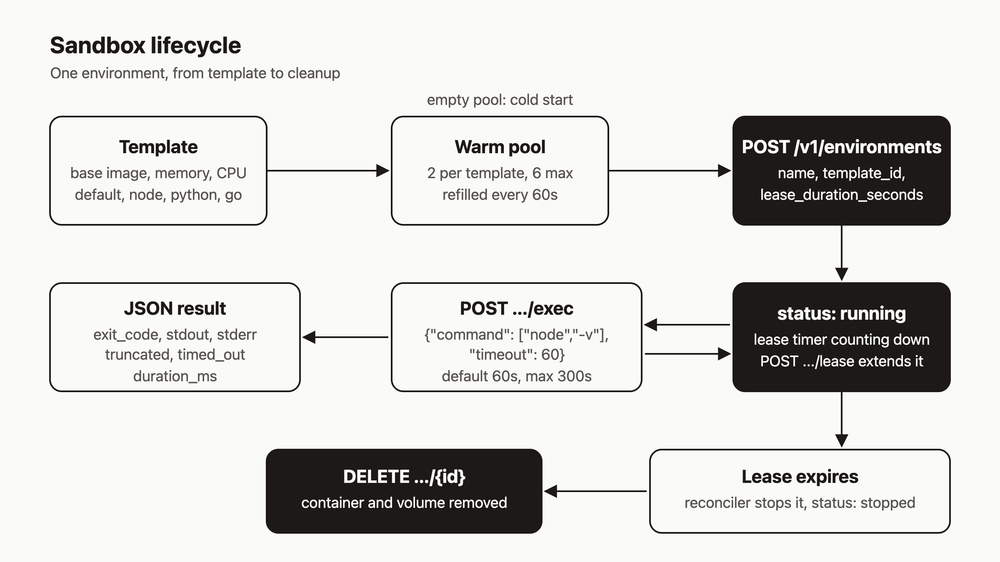

# Give an agent a disposable sandbox to run code in

If your agent writes code, sooner or later it needs to run that code. I think the right place for that is a box the agent can use, break, and throw away. It should not run on your laptop, and it should not run next to your production services. The agent also needs a clear answer after each command: did it work, and what did it print.

This tutorial sets that up. You will create a sandbox from a template, run commands in it, read back exit codes and output, extend its lease, see what happens when a lease runs out, and delete it.

These commands were checked against the source code, not executed for this post. Output shapes come from the handlers and types.

## Prerequisites

- An agentic-hosting API key. The hosted API lives at `https://api.agentic.hosting/v1/`. If you self-host, use your own host.
- `curl`, and optionally the `ahc` CLI.

```bash
export AH_URL=https://api.agentic.hosting
export AH_API_KEY=<your-api-key>
ahc configure --url "$AH_URL" --key "$AH_API_KEY"
```

## 1. Look at the templates

A template fixes the base image and the resources. The seed data ships four: `default` (Ubuntu 24.04), `node` (Node 22), `python` (Python 3.12) and `go` (Go 1.23).

```bash
ahc env templates
# or
curl -s -H "Authorization: Bearer $AH_API_KEY" "$AH_URL/v1/environments/templates"
```

The CLI prints a table with `ID`, `NAME`, `BASE_IMAGE`, `MEMORY_MB`, `CPU_MILLICORES` and `DESCRIPTION`. The API returns a JSON array. To read one, call `GET /v1/environments/templates/{templateID}`. It accepts the template id (like `tmpl_node`) or its name (`node`).

Templates also carry an `egress_policy` field. Do not rely on it. The server reads it and passes it to the container setup, but the Docker client never uses that value to restrict traffic, so treat every sandbox as having whatever network access the host gives it.

## 2. Create a sandbox

```bash
ahc env create my-sandbox --template node --lease 3600
```

Or the same thing over HTTP:

```bash
curl -s -X POST "$AH_URL/v1/environments" \
  -H "Authorization: Bearer $AH_API_KEY" \
  -H "Content-Type: application/json" \
  -d '{"name":"my-sandbox","template_id":"node","lease_duration_seconds":3600}'
```

You get `201 Created` and an environment object with `id`, `name`, `template_id`, `status`, `lease_expires_at` (a Unix timestamp) and `lease_duration_seconds`.

Rules from the code:

- Names start with a letter and contain only letters, digits, hyphens and underscores.
- If you leave out the template, you get `default`.
- The lease defaults to 3600 seconds and must be between 300 and 86400.
- Each tenant has an environment quota, so create fails once you hit it.

Use the `id` from the response for the HTTP calls below. The CLI accepts the name.

## 3. Run a command

```bash
ahc env exec my-sandbox -- node -v
```

Over HTTP, the command is an array, not a shell string:

```bash
curl -s -X POST "$AH_URL/v1/environments/$ENV_ID/exec" \
  -H "Authorization: Bearer $AH_API_KEY" \
  -H "Content-Type: application/json" \
  -d '{"command":["node","-v"],"work_dir":"/workspace","timeout":60}'
```

The response has this shape:

```json
{
  "exit_code": 0,
  "stdout": "v22...\n",
  "stderr": "",
  "truncated": false,
  "timed_out": false,
  "duration_ms": 0
}
```

(The values are placeholders. Your `stdout` will show the real Node version and `duration_ms` the real time.)

`work_dir` defaults to `/workspace`. `timeout` is in seconds, defaults to 60, and is capped at 300. The environment has to be `running`, and `command` cannot be empty. `truncated` turns true when stdout or stderr reaches 1 MiB.

If you need a shell, ask for one: `["sh","-c","echo hi && ls"]`. The `ahc` CLI has no timeout flag, so use the HTTP call when you need something other than 60 seconds.

## 4. Run a command that fails

```bash
ahc env exec my-sandbox -- node -e "process.exit(3)"
echo $?
```

Over HTTP you still get status 200, because the exec itself worked. The failure shows up in the body as `"exit_code": 3`. This trips up agents, so build your loop to check `exit_code` and `timed_out`, not the HTTP status. The `ahc` CLI does this for you. It prints stdout and stderr, then exits with the command's exit code. If the command timed out and the code was 0, `ahc` exits with 124.

## 5. Extend a lease, and see one expire

Extend a running sandbox:

```bash
curl -s -X POST "$AH_URL/v1/environments/$ENV_ID/lease" \
  -H "Authorization: Bearer $AH_API_KEY" \
  -H "Content-Type: application/json" \
  -d '{"duration_seconds":7200}'
```

The response is the updated environment, with a new `lease_expires_at`. The code sets the expiry to now plus `duration_seconds`. It does not add to what was left. The value must be between 300 and 86400, and the environment must be running. There is no `ahc` command for this one.

To see an expiry, make a second sandbox with the shortest allowed lease and wait:

```bash
ahc env create short-lived --lease 300
# about five minutes later
ahc env get short-lived
```

The reconciler runs every 30 seconds. When it finds a running environment past its `lease_expires_at`, it stops the container and sets `status` to `stopped`. It does not delete the environment. A stopped sandbox can't take exec calls (you get a validation error saying it must be running), and `ahc env start short-lived` brings it back with a fresh lease of `lease_duration_seconds`.

## 6. Stop, start, delete

```bash
ahc env stop my-sandbox
ahc env start my-sandbox
ahc env delete my-sandbox --confirm
```

The HTTP routes are `POST /v1/environments/{id}/stop`, `POST /v1/environments/{id}/start` and `DELETE /v1/environments/{id}`. Delete returns `204 No Content`, and it removes the container, the volume and the record. The CLI refuses to delete without `--confirm`. Also delete `short-lived` when you are done with it.

## How it works

The diagram at the end of the post shows the whole path.

A template is a row with a base image, memory and CPU. The server keeps a warm pool: 2 ready containers per template (6 in total), refilled every 60 seconds. When you create a sandbox, it claims a ready container if one exists, so it comes up faster than a cold start. If the pool is empty for that template (the 6-container cap can leave some templates without a ready container), creation falls back to a cold start. I have no timings to give you, so measure it on your own server.

Once running, the sandbox has a lease timer. Every `exec` is one POST with a command array, and it returns one JSON result. Exec runs through `docker exec`, with a `timeout` wrapper inside the container as a backstop. The lease ends in one of two ways. Expiry stops the container. Delete removes everything.

## Exec is not idempotent

Most create-style endpoints on agentic-hosting go through idempotency middleware. Exec deliberately does not. Run the same command twice and it runs twice.

Agents retry a lot, so this matters. If your agent retries after a network error, it may repeat a side effect such as an install or a file write. Make commands safe to repeat, or check state before you retry.

## What to try next

- Put a Python sandbox behind an agent loop: create, exec, read `exit_code`, delete in a `finally` block.
- Read how the reconciler and the warm pool work: https://agentic.hosting/docs/reconciliation/
- Read the exec notes next to the env var docs: https://agentic.hosting/docs/env/
- Look at the agent-focused docs: https://agentic.hosting/docs/for-agents/
- Source and issues: https://github.com/dennisonbertram/agentic-hosting


