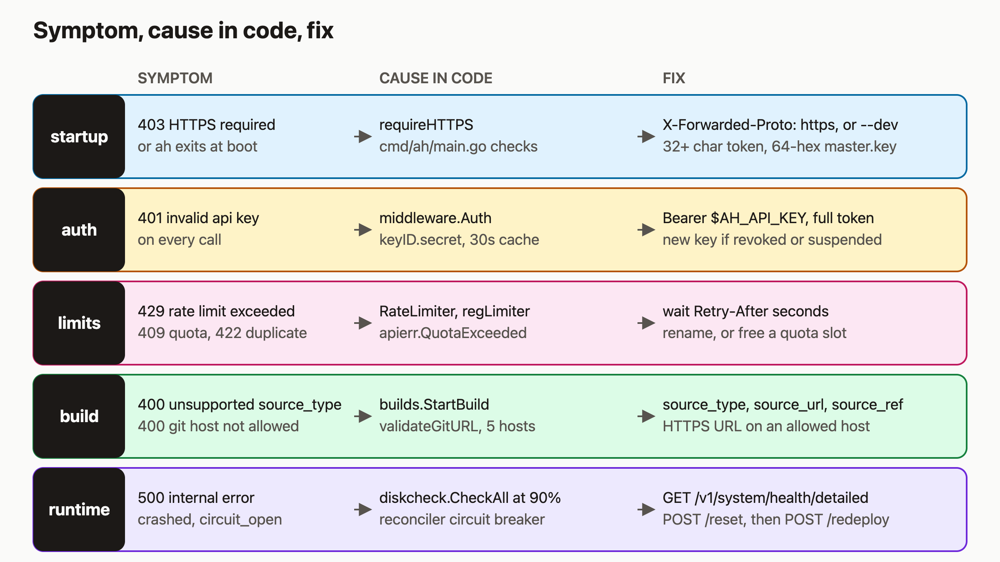

# Fix the ten most common agentic-hosting errors

Most `ah` errors are easy to fix once you know which part of the system produced them. If you hit one in your first hour and pasted it into a search box, you are in the right place. Each error below has the message, the code that raises it, and the command that fixes it.

I think this matters most if an AI agent is the one calling the API. An agent can only recover from an error it can read, so a status code that maps to one clear cause is worth a lot. By the end you will be able to read the HTTP status or log line, know which part of `ah` produced it, and run the fix. The diagram near the bottom is the same information as one lookup table.

I checked these commands against the source. I did not run them for this post, so treat the expected output as the shape the code produces.

## Prerequisites

- An `ah` server you can reach. The hosted API is `https://api.agentic.hosting/v1/`. If you self-host, use your own host.
- For API calls, a key in `$AH_API_KEY` and the base URL in `$AH_URL`.
- `curl` and `jq`.

## 1. `{"error":"HTTPS required"}` on port 8080

In production mode, `ah` listens on 127.0.0.1:8080 behind Traefik. The `requireHTTPS` middleware in `internal/api/server.go` returns 403 when a request comes from loopback without `X-Forwarded-Proto: https`. A request from a non-loopback address must carry TLS itself, or it gets the same 403. Traefik sets the header for you, so this error only shows up when you curl the port directly.

Pick one:

```bash
# Pretend to be the proxy (works only from the same machine)
curl -H 'X-Forwarded-Proto: https' http://127.0.0.1:8080/v1/system/health

# Or use the real HTTPS URL
curl "$AH_URL/v1/system/health"

# Or run ah with --dev, which skips the check
```

Expected output: `{"status":"ok"}`.

## 2. `ah` will not start

Startup failures are `log.Fatalf` calls in `cmd/ah/main.go`. Match the log line (`journalctl -u ah -f`):

| Log line | Fix |
|---|---|
| `AH_BOOTSTRAP_TOKEN must be set` | Put the token in `/etc/default/ah`. The unit loads it with `EnvironmentFile=-/etc/default/ah`, and the `-` means a missing file is silently ignored. |
| `each bootstrap token must be at least 32 characters` | Use a longer token. Comma-separated tokens are allowed, and each one needs 32 characters. |
| `master key must be 64 hex characters (32 bytes)` | Regenerate the key file. |
| `gVisor runtime (runsc) not found in Docker daemon` | Install and register `runsc` with Docker. |

For the master key, the code prints its own generator command:

```bash
head -c 32 /dev/urandom | xxd -p -c 64 > /var/lib/ah/master.key
```

Do not regenerate the key on a server that already has data. Secrets in the database are encrypted with it. Only a fresh install should run that command.

With `--dev`, a missing gVisor is a warning, not a fatal error. Containers still fail to start later, because every container asks for the `runsc` runtime.

## 3. 401 on every call

`middleware.Auth` returns 401 for each of these: a missing header, a token that is not `Bearer <token>`, a token without a dot, an unknown or revoked or expired key, a tenant whose status is not `active`, and a wrong secret. Most of them say only `invalid api key`.

The token is `keyID.secret`, one string with a dot. Check yours:

```bash
echo "$AH_API_KEY" | grep -c '\.'      # expect 1
curl -s -H "Authorization: Bearer $AH_API_KEY" "$AH_URL/v1/tenant"
```

If the format is right, the key was revoked or the tenant was suspended. Auth results are cached for 30 seconds, so a brand-new key works right away. If a key is not accepted, get a new one: registration returns `api_key`, and the recovery route is `POST /v1/auth/recover` with the admin token in the `X-Admin-Token` header. The installer sets one; once an admin token exists, a bootstrap token gets 403. Only a legacy install with no admin token accepts `X-Bootstrap-Token`.

## 4. 422 on register

`POST /v1/tenants/register` returns 422 with `registration failed, please check your details and try again` when the tenant insert fails, which in practice means the name or email is already taken. The message is vague on purpose so it cannot be used to find out which emails exist.

```bash
curl -s -X POST "$AH_URL/v1/tenants/register" \
  -H "X-Bootstrap-Token: $AH_BOOTSTRAP_TOKEN" \
  -H 'Content-Type: application/json' \
  -d '{"name":"my-team-2","email":"me+2@example.com"}'
```

Change the name or email. Note that a malformed email or a name shorter than 2 characters is a 400, not a 422.

A reserved service name is also a creation error, but the code returns 400 for it, not 422. Names such as `api`, `admin`, `www`, `status`, and anything starting with `env-` cannot be used as a subdomain when a base domain is configured. Pick another service name.

## 5. 429: two different limiters

- `rate limit exceeded` or `global rate limit exceeded` comes from the per-tenant and global limiters on authenticated routes.
- `rate limit exceeded, try again later` on register, recover, and reactivate comes from the registration limiter: 5 requests per IP per hour and 20 per hour globally. Failed token guesses count against the per-IP bucket.

Both set `Retry-After`. Wait that long:

```bash
curl -si -X POST "$AH_URL/v1/tenants/register" ... | grep -i '^retry-after'
```

On authenticated routes the value is capped at 60 seconds. On the registration limiter it is the time left in the hour window, so it can be long. Do not retry in a tight loop.

## 6. 409: five different causes

The status code alone does not tell you which one you have, so read the `error` text. The code uses 409 for:

- Quota: `quota exceeded: maximum N services reached`.
- Duplicate label: `subdomain already taken: <label> — choose a different service name`.
- Idempotency: `idempotency key reused with different request body`, or `a request with this idempotency key is still in progress`. Use a new `Idempotency-Key` for a different body.
- Build queue: `build queue full; try again later`. The queue holds 10.
- No container: `service has no container — use POST /redeploy to deploy it`. This is what `/start` returns after a reset. Call `POST /v1/services/{id}/redeploy`.

## 7. Build: `unsupported source_type`

You sent `git_url` and `branch`. The build body uses different names, in `builds.StartBuildRequest`:

```bash
curl -s -X POST "$AH_URL/v1/services/$SERVICE_ID/builds" \
  -H "Authorization: Bearer $AH_API_KEY" \
  -H 'Content-Type: application/json' \
  -d '{"source_type":"git","source_url":"https://github.com/you/app","source_ref":"main"}'
```

A wrong body returns 400 with `unsupported source_type:  (only 'git' is supported)`. A good one returns 202 with `build_id`, `status`, and `image`. `source_ref` defaults to `main`. Environment sync is different and does use `git_url`; only the build API uses `source_*`.

## 8. Build: git host rejected

`validateGitURL` accepts only HTTPS URLs, with no credentials in them, on five hosts: `github.com`, `gitlab.com`, `bitbucket.org`, `sr.ht`, and `codeberg.org`. Anything else is a 400 such as `git host "example.com" is not in the allowed list`. Use an allowed host, and drop any `user:token@` from the URL.

## 9. Disk over 90%: 503 `insufficient disk space`

Before a build, database or kanban create, deploy, restart, or redeploy, `diskcheck.CheckAll` looks at `/var/lib/ah` and `/var/lib/docker`. At 80% it logs a warning. At 90% it returns an error, which the API sends as 503 `{"error":"insufficient disk space; try again later"}` with `Retry-After: 10`.

Service create still returns 201, and the asynchronous deploy fails with `last_error` set. To confirm:

```bash
curl -s -H "Authorization: Bearer $AH_API_KEY" \
  "$AH_URL/v1/system/health/detailed?fresh=true" | jq '.disk, .docker_disk'
```

Look for `used_percent` at or above 90. Free space on the host, for example by removing unused Docker images, then retry. Check what you are deleting first.

## 10. Stock nginx crash loop and circuit open

Containers run with a read-only root filesystem and small tmpfs mounts for `/tmp`, `/var/run`, `/var/tmp`, and `/run`. Stock `nginx:alpine` wants to write elsewhere and exits. Use `nginxinc/nginx-unprivileged` and set the port to 8080.

After 5 crashes in 600 seconds, the reconciler opens the circuit. Read the state, then reset and redeploy:

```bash
curl -s -H "Authorization: Bearer $AH_API_KEY" "$AH_URL/v1/services/$SERVICE_ID" \
  | jq '{status, circuit_open, crash_count, last_error}'
curl -s -X POST -H "Authorization: Bearer $AH_API_KEY" "$AH_URL/v1/services/$SERVICE_ID/reset"
curl -s -X POST -H "Authorization: Bearer $AH_API_KEY" "$AH_URL/v1/services/$SERVICE_ID/redeploy"
```

`status` stays `crashed`; `circuit_open` is the boolean. Fix the image first, or it will trip again. Do not call `/start` after a reset: that is the 409 from step 6. If you do nothing, the reconciler closes the circuit itself after 30 minutes, then 1 hour, then 4 hours on repeat trips, and leaves the service stopped, so you still redeploy.

## 11. Slash command 404

The Claude Code commands are named `/ah-deploy`, `/ah-status`, `/ah-db`, `/ah-logs`, `/ah-register`, and `/ah-snapshot`. `/deploy` does not exist. If the `ah-*` files are missing, re-run the skill install script from the repository.

## How it works



The errors fall into five places in the request path. Startup checks run once in `cmd/ah/main.go`. Every request then passes `requireHTTPS`, then auth, then the rate limiters. Handlers and managers such as `builds.StartBuild` validate input and return typed errors through `apierr`, which is why quota and duplicate errors are 409 and bad input is 400. Anything that is not a typed error falls back to a 500 with `internal error`. A full disk is typed: it returns 503 with `insufficient disk space; try again later` and `Retry-After`. Runtime failures come from the reconciler and its circuit breaker.

## What to try next

- Read the full [troubleshooting page](https://agentic.hosting/docs/troubleshooting/).
- Learn the limits in [rate limits](https://agentic.hosting/docs/rate-limits/) and the key model in [auth](https://agentic.hosting/docs/auth/).
- See how the circuit breaker works in [reconciliation](https://agentic.hosting/docs/reconciliation/).
- Browse the source and open an issue at [github.com/dennisonbertram/agentic-hosting](https://github.com/dennisonbertram/agentic-hosting).
